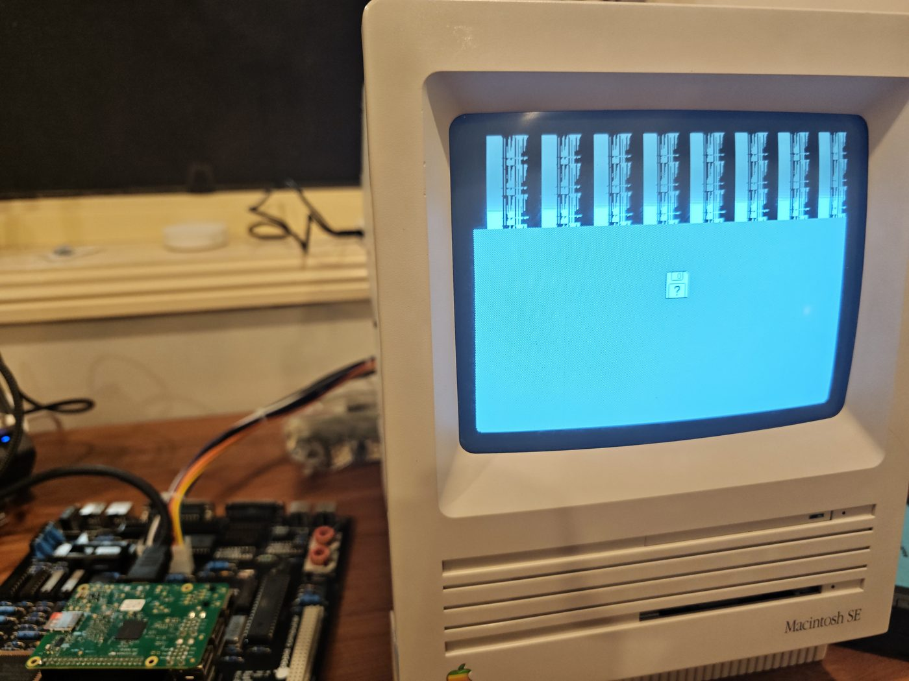
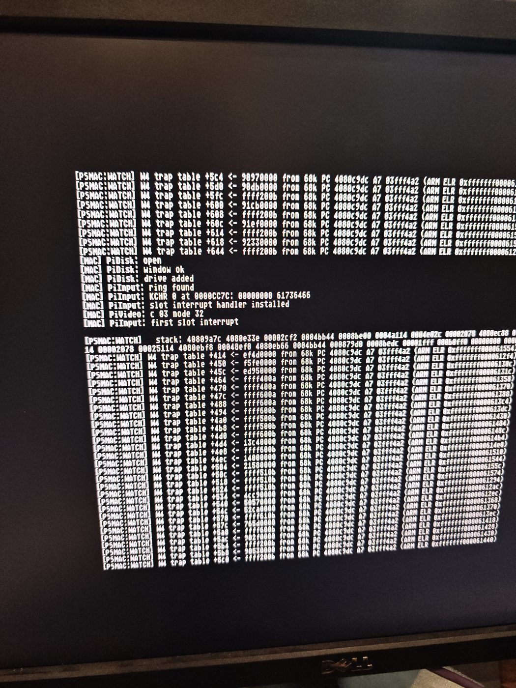
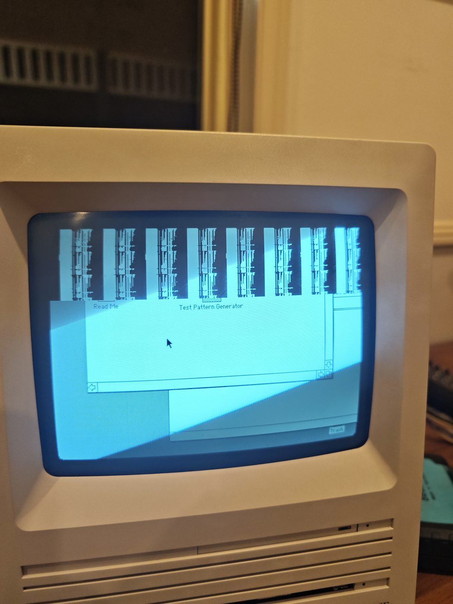
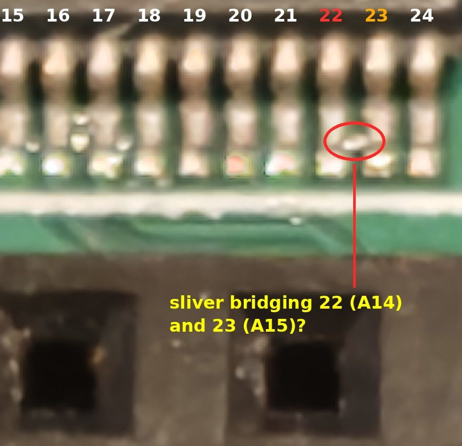
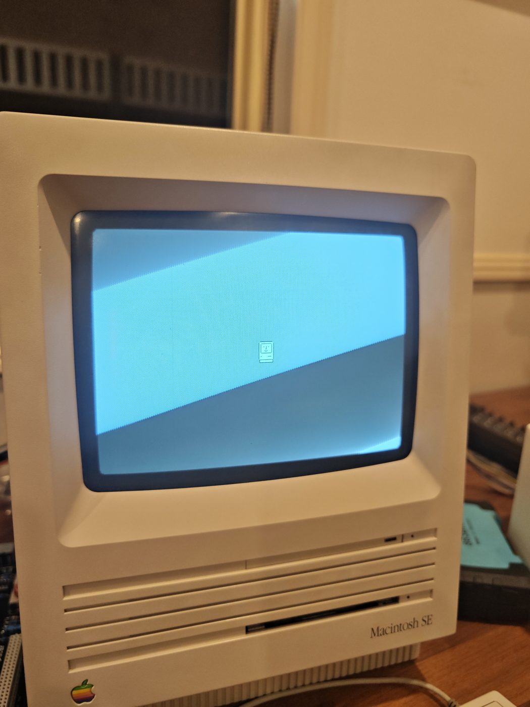
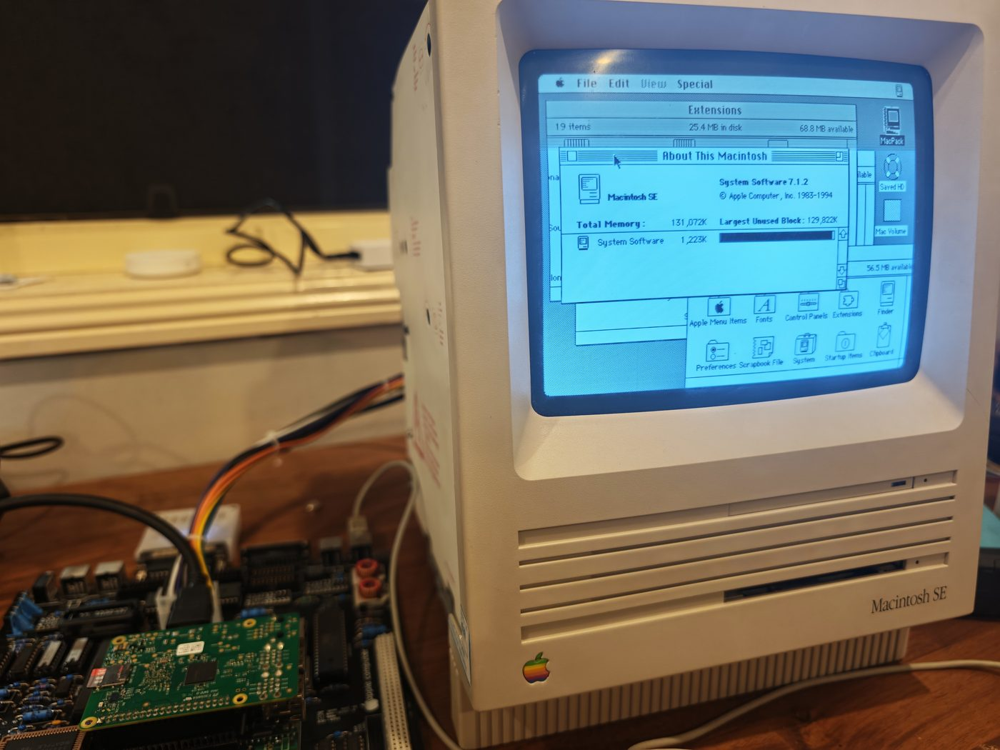
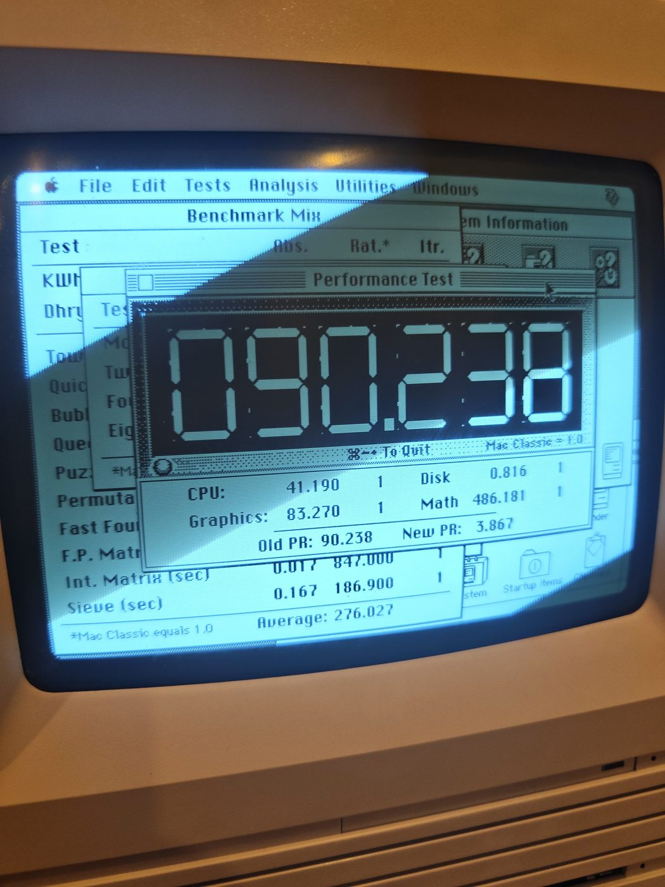

# The real Macintosh SE in pictures

Photographs of the first boots of Aurora68 on a real Macintosh SE, taken on 20 November 2026,
in the order they happened. The hardware: a Macintosh SE with 4 MB of its own memory and a
dead clock chip, a classic PiStorm (Rev B layout, 74LVC16373A latches) built by hand earlier
in the year, a Raspberry Pi 3B on a stacking header, and a BlueSCSI on the SE's SCSI port.
The narrative, with the logs, is in `docs/12-hardware-bringup.md`; the fixes are in
`docs/08-emu68-port-status.md`. The photographs have been scaled down and carry no metadata.

## 1. The first picture: the IIci ROM asks for a disk

The first kernel that got past the clock chip (it reads $FF for every byte; the kernel now
answers in its place) drew the IIci ROM's grey desktop and the question-mark disk on the
SE's own screen. No disk was attached, so this was the right answer. The stripes at the top
were the next problem (section 3).

## 2. The log on the HDMI monitor

With a BlueSCSI attached, System 7 started, and the kernel log on the Pi's HDMI output showed the Macintosh
drivers reporting in: PiDisk opening the card image, PiInput's slot interrupt, PiVideo. The
`[PSMAC:WATCH]` lines around them are a debugging watch on the trap table, harmless; the next kernel
leaves it off unless asked for.

## 3. The Finder, with the top hundred rows missing

System 7.1.2 from the BlueSCSI reached the Finder, and the SE's own mouse moved the pointer.
The top 100 rows of the screen never changed, whatever was drawn there. Row 100 of the SE's
screen buffer starts at $3FC000: every row above it has address bit A14 = 0 and A15 = 1,
every row below it A14 = A15 = 1, and so does every SE chip address the kernel uses (SCSI,
VIA, SCC, IWM), which is why nothing else failed. Two address lines tied together would do
exactly this.

## 4. The cause: a sliver of solder on U2

On the PiStorm the CPLD does not drive the address bus itself: the address is latched into
two 16-bit latches. The design files (`reference/pistorm`, Rev B) put A14 on a single track
from U2 pin 22 to pin 42 of the 68000 header, with A15 on U2 pin 23 beside it. A close
photograph showed a sliver of solder between the two pins. The owner cleaned the spot; the
meter then read open between pins 42 and 43.

## 5. The whole screen

With the bridge gone, the full 512 by 342 screen draws.

## 6. A Macintosh SE with 128 MB

With PiMach in the Extensions folder, About This Macintosh names the machine a Macintosh SE:
System Software 7.1.2, 131,072K of memory (the Pi's RAM; the SE's own 4 MB holds only its
screen buffer), the BlueSCSI's "Saved HD" and the card image's "Mac Volume" on the
desktop.

## 7. Speedometer

Speedometer's performance rating on the real SE, against a Mac Classic (1.0, about an SE's
speed): 90.2 overall, CPU 41.2, graphics 83.3, math 486.2, disk 0.82; the benchmark mix
averages 276. The disk figure is the BlueSCSI on the SE's own SCSI chip, every byte crossing
the PiStorm's bus, which is slower than the Classic's own disk; the card image (PiDisk) does
not go over that bus and is the fast disk.
