# The PC card: a PC in a window on the Mac's desktop

23 November 2026. The owner asked for an x86 card ("Let's make an x86 card and also integrate
https://libreboot.org/"), then: **"Aurora86 needs to run in a window on the Mac desktop."** The PC itself is
Aurora86, a project of its own beside this repository (`/home/user/aurora86` on the development machine, not
published yet): Bochs 3.1, a Pentium II on an i440FX board, whose firmware is Libreboot's QEMU x86 image (coreboot
with SeaBIOS), built freestanding and big-endian with this kernel's own code-generation flags as `libaurora86.a`.
Its documents (`docs/DESIGN.md`, "The card in Aurora68" and "P3: the window"; `docs/STATUS.md`) are the plan and
the record of the PC; this document is the card's: how the Mac sees the PC, how the kernel runs it, how the
window works. (Docs 17 and 18 were taken when this was written, so the number is 19.)

The owner's decisions (23 November 2026): slot $D; the card "Aurora68 PC Card", the program "Aurora68 PC"; 16 MB
of PC memory by default; Libreboot as published; on the SE's one-bit screen graphics scaled and dithered (1:1 as a
choice), text mode always fitting; core 2 where it is free, core 1 in slices on the SE board;
Control-Option-Command-P (and a click, and a menu item) moving the keyboard and mouse between the Mac and the PC.

## The pieces

| Where | What |
|---|---|
| `emu68/src/psmac/psmac_pc.c`, `psmac_pc.h` | the card: its block, the PC's memory, files, start, slices, drawing, input, commands |
| `emu68/src/psmac/psmac_wclip.c`, `.h` | where a window shows (its visRgn as rectangles), the box around the Mac's pointer, the menu-down test: moved out of the video decoder card (`psmac_video.c`, `psmac_videocard.c`) on the same day, both cards use them |
| `emu68/src/psmac/psmac_pc_declrom.h` | the card's declaration ROM, made by `tools/mac/mkpcdeclrom.py` (`make -C mac pc-declrom`) from `mac/a68pc.s` |
| `emu68/src/psmac/psmac_pc_font.h` | the 6 x 13 and 6 x 12 fonts, made by `tools/mkpcfont.py` from the X Window System's misc-fixed (public domain) |
| `mac/a68pc.s` | `.A68PC`, the card's driver, in its declaration ROM |
| `mac/a68pc/pc.c` | the program **Aurora68 PC** (C, the `mac/c` kit), `mac/build/Aurora68-PC.bin` |
| hooks | `psmac_bus.c` (the card's memory, map and start; core 2's slice; the heartbeat's line), `psmac_mmu.c` (slot $D's pages), `psmac_usb.c` (core 1's slice), `psmac_card.c` (the PC's files on the SD card), `psmb.h` (slot $D's addresses), `psmac_diag.c` (the options' group "PC card"): every one inside `#ifdef PSMAC_PC` |

**Only in a kernel built for it.** `cmake ... -DPSMAC_PC=ON -DAURORA86_DIR=/path/to/aurora86` compiles
`psmac_pc.c` and links `$AURORA86_DIR/build/p2/aarch64be/libaurora86.a` (Aurora86's `make p2`). The default is
off: the normal kernel and CI need nothing from Aurora86, and a normal kernel is the same file it was before the
card (checked: the kernel from the commit before the card and the kernel from the card's tree with `PSMAC_PC` off,
both built outside git with the same `SOURCE_DATE_EPOCH`, are the same `Emu68.img` byte for byte). In a PC kernel
the card is in slot $D with `pc=on` and absent otherwise (`pc=off`, the default until it is proven).

## How the Mac sees it

Slot $D: a 1 MiB window at `$FD000000`, again at `$FDD00000` (the slot's 24-bit megabyte, `$D00000` in 24-bit
mode), the declaration ROM at the slot's top (`$FDFFC000`), mapped by the MMU shim as slot $C's are. The ROM has
the board ("Aurora68 PC Card", BoardId 'PC', vendor "Aurora68 project", part "A68-PC") and one sResource of the
project's vendor category, `{$7050, 4, 1, 'PC'}`, "Aurora68_PC", with the driver `.A68PC` for the Slot Manager to
install and open at start-up, as `.A68Video` is.

The window's block (`psmac_pc.h`, `struct a68p_block`; Aurora86's DESIGN planned the offsets):

| Offset | Who writes | What |
|---|---|---|
| $0000 | card | `magic` 'A68P', `version`, `done_seq`, `state` (off, starting, running, paused, stopped, failed), `error`, `mips_x10`, `load`, the instruction count, `core`, `ram_mb`, the screen's change count and the last one drawn, `draw_us`, `mode`, `nat_w`/`nat_h` (the natural size), `focus_ack`, `in_tail`, `draws`, `idle_pm` |
| $0080 | Mac | `cmd_seq`, `cmd`, `arg0`, `arg1`; the place: `screen`, `top`, `left`, `bottom`, `right`, `visible`, `geom_seq`; `clip_tag`, `vis_rgn`, `vis_flags` (the window's visRgn, tagged with the geom_seq it goes with, as Play's); `scale`, `scroll_x`, `scroll_y`, `options`; `focus`; `in_head`; `front` ($D0, the guest scheduler's word); `prog` and `alive` ($D4, $D8: the program says it runs and counts its event loop's turns, "The owner's SE" below) |
| $0100 | card | `message`, in words |
| $0400 | Mac | the input ring: 64 events of 16 bytes (key down and up as Mac virtual key codes, mouse movement and buttons, a Bochs key code, "let everything go") |
| $1000 | card | the text cells (character, attribute), up to 132 x 60 |
| $4E00 | card | the 16 attribute colours and the text screen's numbers (`struct a68p_tinfo`) |
| $5000 | card | the PC's font (VGA plane 2), $7000 the DAC |
| $8000 | both | disks: the image list and the six places (four IDE, two floppies) |

Commands: power on (the PC is built at the first), power off (it keeps its memory and stops running), reset,
pause, resume, Control-Alt-Delete (the card presses and lets go of the three keys), redraw, attach (an image of the
list into a drive: `arg0` the image, `arg1` the place or `A68P_PLACE_AUTO`), detach (out of its drive) and rescan (the
list again from the SD card's root), and since the owner's SE (23 November 2026) the window gone (`A68P_C_NOWINDOW`: the
program quits; the card stops drawing and lets go of every key and button before it answers); "Disks" below says what can go where. Power off and reset first write back
everything the disks still hold. Options: `A68P_O_PCSENSE` (text in
the PC's own white on black on a one-bit screen), `A68P_O_THRESHOLD` (no dither), `A68P_O_BIGTEXT` (the PC's 8 x 16
font on one bit too), `A68P_O_GROWBOX` (the window's bottom-right 15 x 15 left to the Mac's grow box).

`.A68PC`'s calls (`mac/a68pc.s`): Control 100 a command and its two arguments (waits for the card to take it),
112 the place (six longs), 113 an input event, 114 scale, scroll and options, 115 the focus; Status 100 the
window's address in the caller's addressing mode, the version, state and error, Status 101 the block.

## How the kernel runs it

- **Memory.** The PC needs about 95 MiB beside its RAM (Aurora86's harness: "95 MiB of the heap in use" with 16 MB
  of RAM: Bochs's memory, ROM space, the VGA's memory, the decoded-instruction cache), and the 12 MiB firmware file.
  The kernel's heap is about 52 MB, so the card's memory is carved from the Pi's RAM by `psmac_setup_memory`, like
  the frame buffers and the video card's window: the window, the ROM page and `pc.ram` + 104 MiB as a TLSF pool of
  its own (120 MiB with the default 16 MB). The few allocations Bochs's global objects make in their constructors
  come from the kernel's heap: the kernel runs the library's constructors with its own (`start.c`'s `__init_start`
  list) before the pool exists.
- **The core.** The solo board's core 2 is the service core, but light there (the heartbeat, the VIA's time), so
  the PC runs on it in slices of about 2 ms between the loop's turns. On the SE board core 2 is the SE's bus, and on
  the IIci testbed it carries every I/O cycle over the bridge (found while writing this: the design had counted the
  testbed's core 2 as free), so there the PC runs on core 1 in slices of about 1 ms between the sound output's turns
  and the video decoder's. `pc.core=1|2` chooses. A slice's length in instructions follows the measured rate.
- **Idle.** Bochs paces the PC's clock (`clock: sync=both`: its timers in real time, and its time never more than a
  second ahead of the Pi's): while the PC halts (the firmware waiting, DOS idle with HLT) it sleeps a millisecond at
  a time, and the library ends the slice there and says how long (`a86_pc_idle_us`); the core does other work
  meanwhile.
- **Files.** `pc.rom=` (Libreboot's 12 MiB image), `pc.vgarom=` (SeaVGABIOS for Bochs's VGA) and `pc.disk0=` (a hard
  disk image, 16 heads and 63 sectors a track), in the SD card's root, read on the PC's core under the card's lock
  (`psmac_card_pc_open`/`_read`: a file's clusters listed once, then any part read a cluster at a time), or in the
  testbed host files through semihosting. The firmware is read a megabyte per slice; the disks on demand, through
  `a86_disk()`'s callbacks; what the PC writes goes back into the image files ("Disks", below).

## Disks

Added on 23 November 2026, the day after the card (docs/08 item 133). The PC has two hard disks on its first IDE channel
(`pc.disk0=`, `pc.disk1=`) and a CD-ROM drive on the second (`pc.cd=`, ISO 9660 images); each is an image file in the SD
card's root (host paths in the testbed). Images that the PC's options name are the PC's: the card no longer offers them
to the Mac as disks too (a `freedos.img` in the root had been taken as a Mac disk image, loaded into the Mac's memory and
shown to the Finder, which asks to initialise a disk it cannot read).

- **Writing back.** What the PC writes goes into the Pi's memory first, by sector (the overlay), and from there back into
  the same file, in place: into the file's own clusters as listed when it was opened (`psmac_card_pc_write`, a cluster's
  sectors a command), never growing it, never touching a directory entry or a FAT sector, as the Mac's PiDisk images are
  written. So the card's file system is the same before and after, whatever happens between. When: 2 seconds after the
  PC's last write to that disk (DOS's writes come in bursts: a file is a few sectors of FAT, directory and data), 10
  seconds after the oldest change not yet written at most, and all of it at once when the program powers the PC off or
  resets it, and when an image leaves its drive. The writing happens on the PC's own core between its slices, 4 ms a turn
  at most; sectors written leave the overlay. The log says each time: `[PC] freedos.img: 4 sectors written back to the
  card (0 ms)`. **PC > Power Off before switching the Pi off** is how to be sure everything is on the card; the block's
  `disk_dirty` counts what is not yet. A write that fails stops the writing back for that disk (its changes stay in
  memory) and says so in the log and the program. `pc.disk0ro=on` (`pc.disk1ro=on`) keeps a hard disk's file as it is:
  its changes stay in memory and are lost when the Pi stops, as before this day. A CD is read only.
- **Changing disks.** The Disks menu of Aurora68 PC lists the options' images and the card root's `.iso`, `.vhd`, `.hdd`,
  `.ima`, `.flp` and `.vfd` files (`.img` stays the Mac's unless an option names it; Disks > Look on the Card Again reads
  the root again), each with its kind, checked while it is in a drive. Choosing a CD puts it into the CD-ROM drive, or
  takes it out (Aurora86's new `a86_pc_media()`: Bochs's own runtime media change, the path and status parameters of the
  drive and its runtime-options handlers). FreeDOS 1.4's start (UDVD2, SHSUCDX) finds the empty drive as D:, and a CD put
  in later reads there. Hard disks stay while the PC exists, as in a real PC (the program says so). **Floppies cannot be
  used**: Libreboot's SeaBIOS is a coreboot build, which knows only the floppy drives coreboot's CBFS lists (`etc/floppy0`,
  SeaBIOS's `hw/floppy.c`; the CMOS's drive types are read only in QEMU builds), Libreboot's QEMU image lists none, and DOS
  reads floppies through the BIOS: a drive configured in Bochs took the image and DOS answered "unknown command given to
  driver". So the card configures no floppy drive and the program says why. SeaBIOS under coreboot also ignores the CMOS's
  boot order: it tries the CD-ROM drive first ("Boot failed: Could not read from CDROM (code 0003)" when empty), then the
  hard disk; `pc.cd=` a bootable CD starts the PC from it.

## The picture

The card draws the PC's screen itself, into the frame buffer of the Mac's screen the window is on (screen 0: the
SE's own on the SE board, the HDMI screen on the solo board; screen 1: the SE board's HDMI screen), at that screen's
depth, 30 times a second at most and only the part that changed: the PC's dirty rectangle, the window's whole content
after it moved, was resized or uncovered (the program's update event asks for a redraw), the cursor's cell at each
blink (266 ms). It draws only inside the window's visRgn (read through the Mac's memory before each picture), never in
the box around the Mac's pointer, never while any program's menu is down, and not while the program says the window is
being dragged or resized.

**The pointer's box** (24 pixels each side of the Mouse point, `psmac_wclip_cursor_box`): the Mac draws its pointer into the
frame buffer and keeps what was under it, so the card leaves the box alone while the pointer is there (not while the
pointer is hidden: CrsrVis, $8CC, 0). Until 23 November 2026 the box went back into the one dirty rectangle at every
picture: it was drawn once the pointer had moved on, but the dirty rectangle then spanned the pointer and whatever else
changed (the cursor's cell at each blink: much of the window, 30 times a second), and the Mac puts back what was under
its pointer at the VBL after the Mouse global changes, which can come after the card's picture of that place, leaving an
old piece (or a black square) there. Now the part left out is kept with the box it was left for, and when the box moves
or goes it is drawn at once and again 100 ms later. And the box is wider across: the Mac saves and puts back what is
under its pointer in whole longs of the frame buffer (32 pixels at one bit), so the testbed, with text scrolling under a
resting pointer, showed two letters left blank just right of a 48-pixel box once the pointer moved on; the box is now
rounded out to 32 / depth pixels (64 or 96 wide at one bit). The video decoder card (`psmac_video.c`) shares the box and
does the same for a paused, ended or starved film, whose last picture was drawn again only when its window moved.

- **Text** is drawn from the cells. On a one-bit screen in a 6 x 13 font (the X Window System's misc-fixed, the
  PC's code page 437 with its box drawing), 80 x 25 in 480 x 325; but **the SE's screen is too short for that**: 342
  lines less the menu bar (20) and a document window's title bar and frame (21) leave 301, so on a screen under 366
  lines the card uses misc-fixed's 6 x 12, 80 x 25 in 480 x 300, which fits (Aurora86's DESIGN had 6 x 13 fitting
  "with the window's frame": it does not, by 24 lines). A cell is drawn as the negative of the PC's own picture by
  luminance: whichever of its two colours is lighter is black, the darker white. So DOS's grey on black is black on
  white, and a light dialog (FreeDOS's installer, black on grey) white on black, as the pictures show; `View > White on
  Black` gives the PC's own sense. On deeper screens the PC's own font (8 or 9 x 16) in its 16 colours, through the screen's
  colour table at 2 to 8 bits. Two pixels of paper each side of the text (`TEXT_INSET`, in the colours of the row's first
  and last cells; the natural width 484 for 80 columns of 6, 644 or 724 in colour): misc-fixed's glyphs, and the VGA's,
  use their cell's first column (C, D, the box lines), which touched the window's one-pixel frame, so that the first
  QEMU pictures read "D-ROM not configured" for "CD-ROM" and "one processing" for "Done processing" (the letters were
  all there: the pixels show the C's left stroke one pixel from the frame line, 23 November 2026).
  Before the PC's first picture (and when it is in no mode) the window is the PC's background as its text will be drawn:
  white on one bit (black with White on Black), black on deeper screens; it was black on one bit too.
- **Graphics** (VGA and Bochs VBE modes, the 32-bit picture the library keeps) are scaled to the window by the nearest
  pixel, ordered-dithered (8 x 8) on one bit, through a 4096-entry table of the screen's colours at 2 to 8 bits; `View
  > Actual Size` shows them 1:1.

## Aurora68 PC

`mac/a68pc/pc.c`, a C program with the `mac/c` kit, in `Aurora68:Aurora68 PC` (`tools/mac/aurora68-layout.py`). A
document window with grow and zoom boxes, titled with the PC's state ("Aurora68 PC (off)", "... (starting)", and
": keyboard and mouse to the PC" while captured); 484 x 300 at first, which fits the SE's screen; zoomed, the
picture's natural size. Menus: **PC** (Power On, Power Off, Reset, Send Control-Alt-Delete, Pause), **Disks** (Look on
the Card Again, then the card's image list with each image's kind, those in a drive checked: choosing a CD puts it in or
takes it out; when the card does not do what was chosen, a box says why in the card's words), **View** (Scaled to the Window, Actual Size, Large Text (8 x 16), White on
Black), **Keyboard** (Capture Keyboard and Mouse (Control-Option-Command-P)). It powers the PC on when it starts if
the PC is off.

The program draws nothing in the window but the grow box: it tells the card the window's content rectangle in the
screen's pixels and hands over its visRgn handle (tagged, as Aurora68 Play 1.8 does), again whenever the window moves,
is resized, zoomed, activated, or the program is suspended or resumed; while it drags or resizes the window it says
"not visible". **Capture**: a click in the window, the menu item or Control-Option-Command-P while the window is in
front gives the PC the keyboard and mouse; the same key, a Command-click, or the window going to the back gives them
back (the card lets go of every key the PC holds). While captured the program adds keyUpMask to SysEvtMask ($144) so
that key releases arrive, passes key-downs and key-ups as Mac virtual key codes (auto-key events are not passed: the
PC repeats keys itself), the modifier keys as presses of their own from the events' modifiers (Command as the
Windows key, Option as Alt, Control as Control), hides the pointer and reads the mouse's movement at each null event
from the window's middle, putting the pointer back there (MTemp, RawMouse and CrsrNew, the trick games of the
period used). The card maps the ADB extended keyboard's codes onto Bochs's (`mac2pc` in `psmac_pc.c`).

## How it was tested (23 November 2026)

- **On the host**, `tools/pccard_test.sh` (part of `make -C mac check`, skipped without `AURORA86_DIR`): `psmac_pc.c` itself
  with Aurora86's x86-64 library, drawing into a pretend Mac screen and typing into the ring as the program does.
  Libreboot's banner on 512 x 342 at one bit; FreeDOS 1.4 to its installer, "No - Return to DOS" chosen, `ver` typed and
  answered; the installer on an 8-bit screen in the PC's colours.
  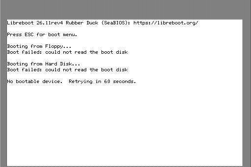 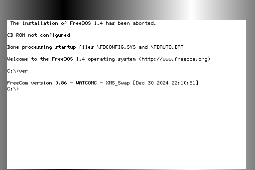
  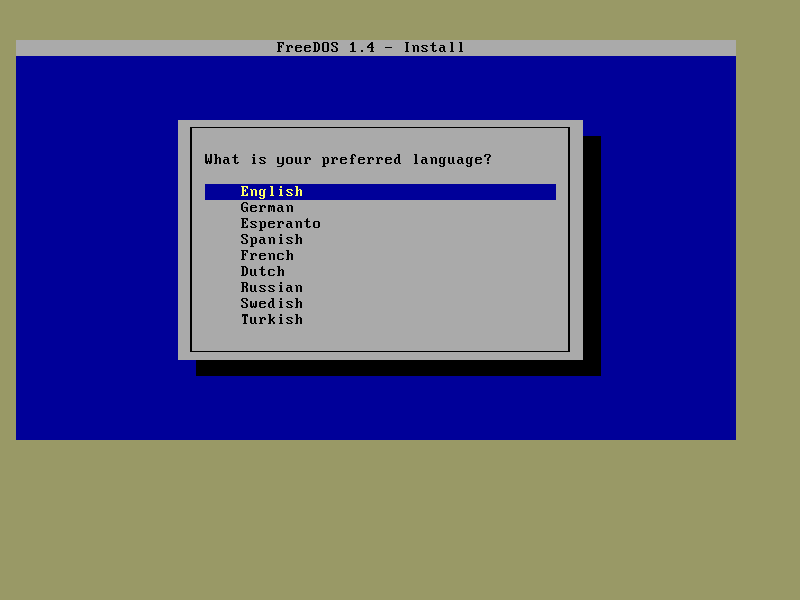
- **In QEMU, the solo board with System 7.1** (the PC kernel, `pc=on`, the files through semihosting, Aurora68 PC in
  Startup Items, QEMU's USB keyboard and mouse moved through its monitor), at 640 x 480 and 512 x 342, one bit: the
  installer in the window; a click captures; the installer left and `ver` typed at `C:\>`; Control-Option-Command-P gives the
  keyboard and mouse back; the window dragged and redrawn where it went; the program's About box over the window left
  alone while the PC's cursor blinked behind it, and the window redrawn when it went; the window made smaller with its
  grow box (the picture clipped to it, 1:1 for text) and zoomed back to the PC's natural size.
  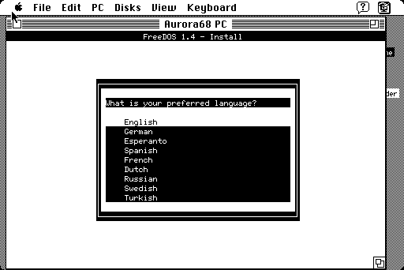 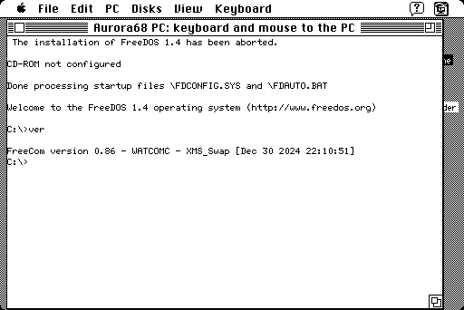
  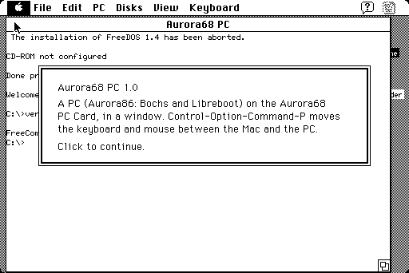 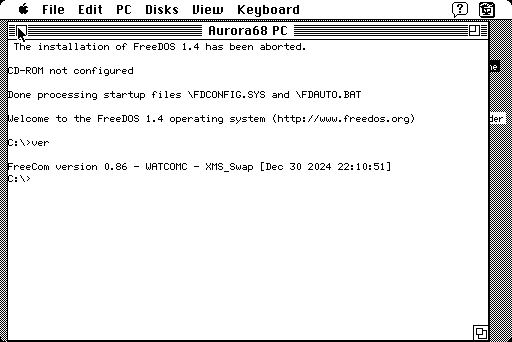
  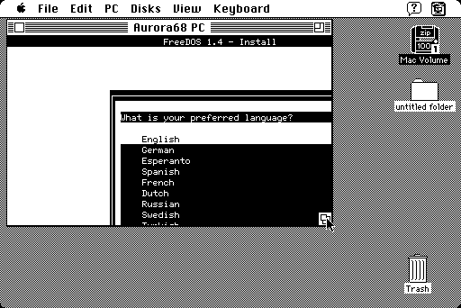 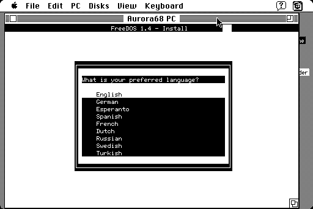
  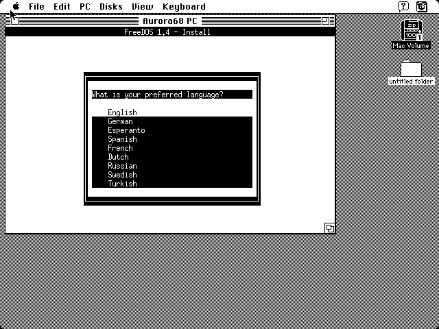 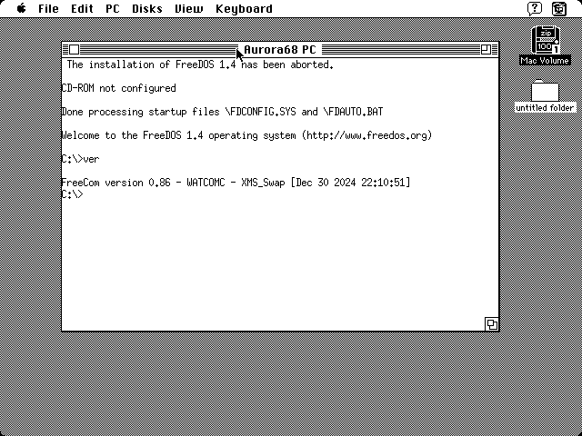
  The zoomed picture shows the one thing left undrawn by design: the box around the Mac's pointer (here over the title
  bar, its lower half inside the window) is drawn once the pointer moves on, as the video decoder card does.
  The first run's picture of the captured PC (`img/pc-card-qemu-dos-captured-640.png`) shows the black square the hidden
  pointer's box left, fixed since (no box while CrsrVis is 0).
- **Speed** in QEMU: paced to real time (`clock: sync=both`); about 20 MIPS by the Pi's clock while the firmware and the
  installer waited (the core mostly idle), 1-2 MIPS at FreeDOS's prompt, which polls the keyboard without halting (the
  core busy; FDAPM's idle would let it rest). QEMU's speed is its translator's, not a Cortex-A53's.
- **Not tested:** the SE board, the IIci testbed, real hardware, the SD card's file path, colour in QEMU (the host test
  covers the 8-bit drawing), graphics modes.

The second round (the same day, docs/08 item 133):

- **On the host** (`tools/pccard_test.sh`): the picture with the inset (484 wide); a scratch copy of FreeDOS 1.4 (the
  download stays as it came); `echo WRITTEN BY THE PC>a68test.txt` at `C:\>`, and a second process (a kernel started
  again) types the file; with `pc.disk0ro=on` a `del` of it is not kept; two CDs made by `tools/mkiso.py` put into the
  CD-ROM drive in turn and read at D:; FDAPM's idle measured (above).
- **In QEMU**, the solo board with System 7.1, **the files on an SD card image** (`run-solo.sh`'s `CARD=`: a 64 MiB image,
  an MBR and a FAT32 partition holding `aurora86.rom`, `aurora86-vga.bin`, `freedos.img` and `dosdata.iso`; the System's
  disk still through semihosting). At 640 x 480: the firmware read from the card (about 25 s of QEMU's time for 12 MiB),
  the installer, DOS; a file written at `C:\>` and on the card 2 s later ("freedos.img: 4 sectors written back to the
  card (16 ms)"); the CD put in from the Disks menu; PC > Reset and the file typed again. Then QEMU and the kernel started
  again with the same card image at 512 x 342: the file typed back, the Disks menu, the CD read at D:; and on the host,
  `mtype` found the file inside the card image's `freedos.img`. The text's first column clear of the frame at both sizes;
  the window white before the first picture.
  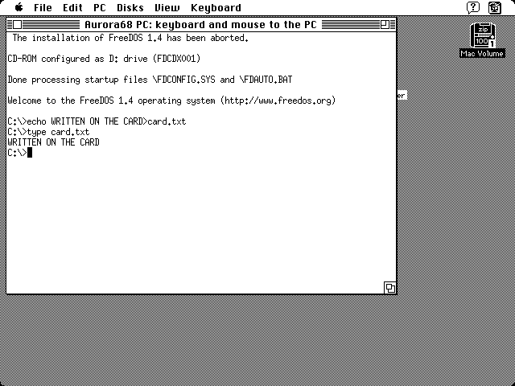 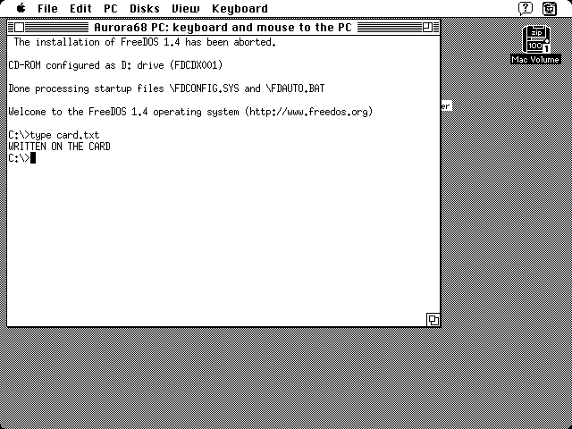
  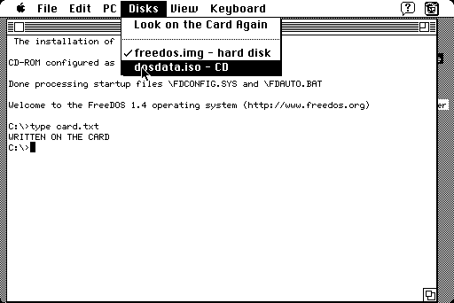 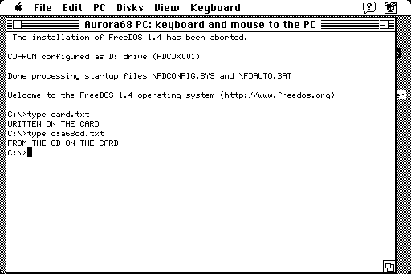
- **The pointer's box**, with a file typed so that it scrolls under the resting pointer, the pointer then moved away: with
  the 48-pixel box two letters stayed blank just right of it ("CD.ERROR %  RORLEVEL%"); with the box rounded out to
  the frame buffer's longs, nothing is left. While the pointer rests, its box shows what was there when it came (by design).
  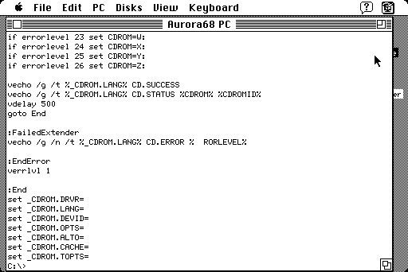
  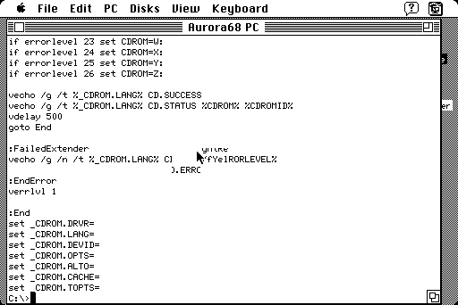 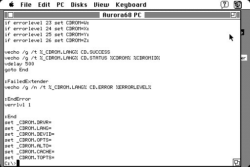
  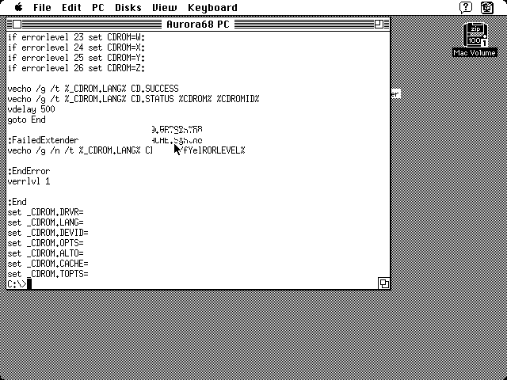 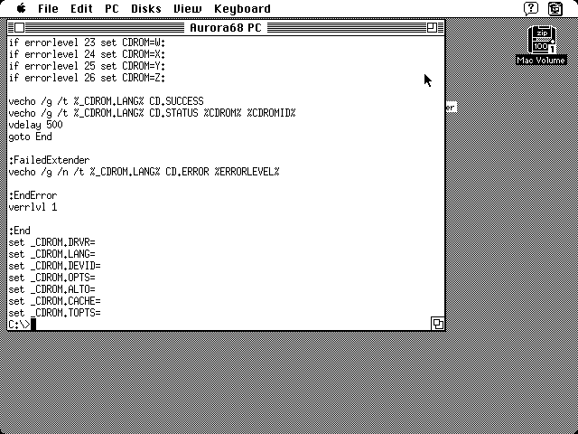
- **FDAPM** at `C:\>` in QEMU: 993 per mille of the core busy before `fdapm apmdos`, 93 busy and 894 idle after.
- **Still not tested:** the SE board, the IIci testbed, real hardware (the owner's Pi is next), a CD's own start (`pc.cd=`
  with a bootable image), `pc.disk1=`, graphics modes, colour in QEMU.

## The owner's SE: the program quits, two screens, the mouse, the sound, the missing disk (23 November 2026)

The first time the card ran on the owner's SE (the PC kernel, `pc=on pc.disk0=freedos.img`; the SE's own 512 x 342 screen
the main one at 0,0, the 2560 x 1440 HDMI screen to its right) five things went wrong. docs/08 item 138 is the record.

- **Drawing after the program had quit.** The PC's screen (SeaBIOS's text) came out on the desktop, over and under the
  Finder's windows, on both screens, while `aurora68.py windows` listed only the Finder's: Aurora68 PC had quit, and the
  heartbeat went on counting pictures. Aurora68 PC's main loop ended with `capture(0)` and told the card nothing; the card
  went on drawing at the last place, through `vis_rgn`, the handle of a window whose heap had gone: freed memory read as a
  region. Now both sides:
  - *The program* says it runs (`prog = A68P_PROG_LIVE`) and adds 1 to `alive` at every turn of its event loop and of
    its boxes' loops. Before it quits it gives the keyboard and mouse back, writes `prog = A68P_PROG_GONE`, `visible` 0,
    `clip_tag` and `vis_rgn` 0, `geom_seq` + 1, and sends `A68P_C_NOWINDOW`, which the driver waits on: the card has
    stopped drawing before the heap is freed. A patch on `ExitToShell` (installed at the start, `GetToolTrapAddress` /
    `SetToolTrapAddress`, $A746 / $A647) does the same stores on any other way out that goes through the trap (a crash the
    system survives, Force Quit), puts the trap back as it found it, and goes on into it.
  - *The card* draws only while `alive` moves (standing still for `A68P_ALIVE_MS`, a second: the program is not running,
    has crashed, or the Mac is held up; drawn again in full when it moves), only with a region once a program says LIVE,
    and only through a region that reads as a live one (`psmac_wclip_rgn_ok`, shared with the video decoder card): the
    handle's master pointer in RAM, the block it points to a relocatable block (the header's tag, 8 bytes back in a
    24-bit zone, 12 in a 32-bit one) of the zone the handle belongs to (the relative handle; the zone's `bkLim` beyond the
    block), big enough for the region, `rgnSize` even and 10 to 8192, its box in order and inside the window, a last
    $7FFF. The block's `nodraw` says why nothing is drawn (hidden, gone, the loop standing still, a region refused, none
    yet) and the heartbeat's `[PC]` line too. Every key and button the PC holds is let go when the window goes or the
    loop stops. The video decoder card refuses a region that is not live the same way (a program that crashed or quit
    without STOP left it a handle into freed memory, and a paused or starved film's last picture is drawn again whenever
    the pointer moves); its programs have no heartbeat yet, so a stale heap that is still intact passes there.
- **The two screens.** Read and tested on the host: the program's mapping (now `mac/a68pc/place.h`, which `pc.c`
  includes) finds the screen from the GDevice list, each device's `gdRect` and its driver's slot (slot $A is HDMI), and the
  window's content in that screen's pixels; the card draws into that screen's frame buffer at those coordinates.
  `tools/pcplace_test.c` (in `make -C mac check`, no Aurora86 needed) runs the program's own lines against a pretend Mac
  memory: the SE's screen main with HDMI to its right (also raised by 400), HDMI main with the SE's to its right and to its
  left, in 32-bit and 24-bit mode; a window on either screen, across both, at HDMI's far edge. Nothing was wrong with the
  mapping; two things changed: the screen is now the one holding most of the window (it was the one under the content's
  top left, so a window mostly on HDMI with its left edge on the SE was drawn on the SE in a strip), and the pointer's box
  (`psmac_wclip_cursor_box`) masks master pointers in 24-bit mode, where it never found the screen (found by the test:
  four failures with the old code). `tools/pccard_test.sh` adds runs with a second screen (1024 x 768 at 8 bits as HDMI):
  the window on HDMI is drawn there in its place and nowhere else, the SE's screen untouched, and the other way round.
- **The mouse that kept selecting icons.** Nothing in the card or the program puts a mouse button into the Mac's input: the
  card's only input path is the PC's (`a86_pc_mouse`, `a86_pc_key`), `.PiInput` takes its ring from the service core's USB
  and Bluetooth drivers only, and the program writes only MTemp, RawMouse and CrsrNew while captured. Not reproduced.
  Fixed on every path found: the card lets go of the PC's mouse buttons as well as its keys (`A68P_IN_RELEASE`, the window
  gone, the loop stopped); capture ends on quit, deactivate, suspend, any click outside the content, a menu, a drag. The
  likeliest explanation is the drawing above: the PC's text drawn over the Finder's icons at 30 pictures a second on a
  one-bit screen looks like icons being selected and unselected as the pointer moves.
- **Noise on HDMI after the chime.** On the SE board the PC runs on core 1 (core 2 is the SE's bus, which cannot wait,
  and core 3 the service loop, 86 per cent busy on the owner's SE), and core 1 also refills the HDMI sound's DMA ring: six
  8 ms blocks, 48 ms, played again and again when not refilled. The PC's start read its 12 MiB firmware a megabyte a turn
  from the SD card, and its build, slices, disk reads and drawing could hold core 1 longer than the ring lasts. The PC
  (and the Apple II card, merged the same day: both are guests of `psmac_guest.c`) cannot leave core 1 on the SE board:
  core 2 there is the loop that serves every one of the 68k's bus cycles to the SE's chips and the SE speaker's deadlines,
  and a slice on it would hold the Mac; core 3 is the service loop. So the sound goes first: the guest scheduler gives
  it its turn before each guest's service and after its slice, and the guests call `psmac_guest_yield` inside their long
  work, at most once a millisecond, on core 1 only: the PC in `a86_host_ns` (which Bochs calls several times a
  millisecond), between disk pieces, write-back runs and 16 rows of drawing; the firmware is read 8 KiB at a time, 64
  KiB a turn; before the two steps that cannot yield (opening the disks, which lists each image's clusters; the PC's
  build) the ring is filled with silence (`psmac_audio_pause`, as a USB enumeration does), so a long step is a moment
  of silence, not old sound. The solo board's guests stay on core 2 (its light service core). The heartbeat's audio line
  now says core 1's longest wait between two refills and how many waits were over 32 ms, also in QEMU.
- **"No bootable device".** The heartbeat's "disks 0 reads" meant `pc.disk0=` had not been attached, and only the log's
  scrolled-out start said why. The lookup was not the cause as far as can be read: `psmac_card_pc_open` finds a root file by
  its long name or its 8.3 name in any case, and a file Setup and Recovery's `put` wrote (`aurora68.up`, renamed into place)
  is found like any other. Now the reason is said: in the disks block's `note`, which Aurora68 PC shows in a box over its
  window once ("No hard disk: pc.disk0=freedos.img is not in the SD card's root (image files there: FD14LITE.IMG)." and
  the like: a folder, empty, damaged clusters, no card, too small, a floppy's size, none named at all), in the heartbeat's
  `[PC]` line, and in the log. One cause found on the way: option values ended only at a space, so a `cmdline.txt` with
  Windows line ends would have handed the kernel `freedos.img\r` for the last word; `psmac_option` (and the card's
  `pc_owns`) now end a value at any white space or control character.

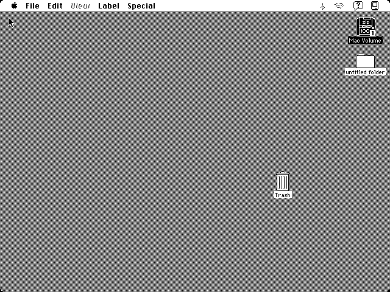 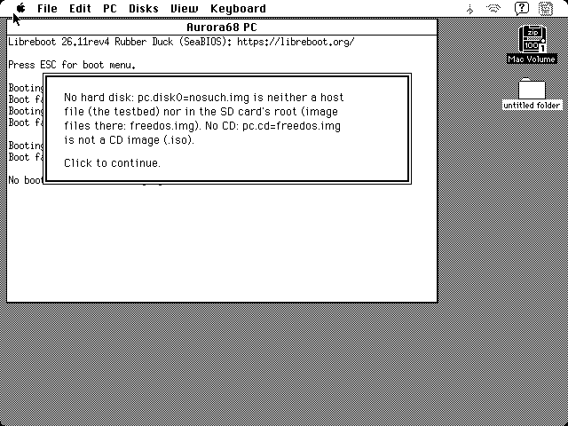

## Options

| Option | What |
|---|---|
| `pc=on` | the card in slot $D and the PC started with the Mac (off by default; only in a kernel built with `-DPSMAC_PC=ON`) |
| `pc.ram=MB` | the PC's memory, 16 by default (4 to 256); the card takes this plus 104 MiB of the Pi's RAM |
| `pc.core=1\|2` | the Pi core: by default 2 on the solo board, 1 elsewhere |
| `pc.rom=NAME`, `pc.vgarom=NAME` | the firmware and the VGA BIOS in the card's root: `aurora86.rom` and `aurora86-vga.bin` by default (host paths in the testbed) |
| `pc.disk0=NAME`, `pc.disk1=NAME` | hard disk images in the card's root, IDE 0 master and slave; the PC's writes written back into them ("Disks") |
| `pc.disk0ro=on`, `pc.disk1ro=on` | that disk's file kept as it is: its changes stay in the Pi's memory |
| `pc.cd=NAME` | an ISO image in the CD-ROM drive (IDE 1 master) at the start; the Disks menu changes it |
| `pc.img1=PATH` ... `pc.img8=PATH` | testbed only: more images in the Disks menu (semihosting cannot list a host directory) |
| `pc.testwin=S,L,T,R,B` | testbed only: the window's place set by the kernel (no program needed), the whole rectangle drawn |
| `pc.textlog=1` | testbed only: every changed line of the PC's text screen into the log, `[PC] \| text` |
| `pc.yield=off`, `guest.yield=off` | testbed only: core 1 as it was before 23 November 2026 (no turns for the sound inside the PC's work, the firmware a megabyte a turn; `guest.yield=off` for the scheduler's and both guests'), to compare |

## What the owner copies to the SD card

From an Aurora86 checkout after `make firmware p2` (firmware never committed anywhere):
`build/firmware/pc.rom` (the 12 MiB Libreboot image) as **`aurora86.rom`**, `build/firmware/vgabios-bochs-stdvga.bin`
as **`aurora86-vga.bin`**, and a disk image (for instance FreeDOS 1.4's `FD14LITE.img`, which Aurora86's
`make test-freedos` fetches) as, say, `freedos.img` with `pc.disk0=freedos.img`; a kernel built with `-DPSMAC_PC=ON`
as `kernel8.img`; `pc=on` in `cmdline.txt`; Aurora68 PC on the Mac. The PC writes into `freedos.img` from 23 November
2026 on: keep a copy of the image elsewhere, and use PC > Power Off before switching the Pi off. CD images (`.iso`) in
the root appear in the Disks menu.

## Idle at the DOS prompt (FDAPM)

FreeDOS's prompt waits for a key by asking the BIOS whether one is there, over and over, without halting: Bochs's most
expensive kind of work (port I/O, interrupts), so the PC's core is busy all the time it shows `C:\>` (in QEMU 1-2 MIPS
and 999 per mille busy, 23 November 2026). FreeDOS's own power manager, FDAPM, makes DOS halt in its idle calls
(`APMDOS`: HLT when DOS or a program waits for a key), and halting is what Bochs's pacing turns into the core's rest
("Idle", above). Measured with the card's own code on the host (`tools/pccard_test.c`, FreeDOS 1.4 at `C:\>`): 999 per
mille of the core busy and 0 idle before, **8 busy and 990 idle** after `fdapm apmdos`. Bochs has no cheap way to see a
keyboard-polling loop from outside (it would have to recognise the BIOS's INT 16h function 1 in a loop); FDAPM is the
fix that real PCs of the time used too. So the owner adds it to the FreeDOS image, from inside the PC (the card writes it
back to the card now):

1. At `C:\>` type `edit fdauto.bat`.
2. Find the line `rem FDAPM APMDOS` (FreeDOS 1.4's `FDAUTO.BAT` has it, after `call CDROM.BAT`) and delete `rem ` so that
   it reads `FDAPM APMDOS`.
3. Save and leave through EDIT's File menu (Option is the PC's Alt: Option-F, then Save, then Exit); then PC > Reset,
   or type `fdapm apmdos` once by hand for now.

If a program runs slower with it, `FDAPM ADV:REG` is the gentler setting (FDAPM's own advice when it loads).
`FDCONFIG.SYS` needs nothing. In the installer's image (`FD14LITE.img`) the line comes before `SETUP.BAT` starts the
installer, so FDAPM is loaded by then (whether the installer's menus wait in DOS's idle call was not measured).
