# The Apple II card: an Apple II in a window on the Mac's desktop

23 November 2026. The owner asked for the Apple II family beside the PC card (docs/19-pc-card.md), and answered the
questions of its design: **the 8-bit machines first** (II, II+, IIe, enhanced IIe, IIc), **1:1 on the SE's screen**
(280 x 192 hires, exact pixels) with a scaled option, **the front window's machine first** when the PC and the Apple
share a Pi core, and ROM dumps the owner will make of their own machines. The Apple itself is Aurora65, a project of its
own beside this repository (`/home/user/aurora65` on the development machine, not published): our own 6502/65C02, the
machines' memory and switches, the Disk II, a block-device card with its own firmware, the picture and the disk images,
built freestanding and big-endian with this kernel's own code-generation flags as `libaurora65.a`, driven through
`aurora65.h`. Its `docs/DESIGN.md` ("The card in Aurora68", "The guest scheduler on the shared core", "P3 as built") and
`docs/STATUS.md` are the plan and the record of the Apple; this document is the card's.

## The pieces

| Where | What |
|---|---|
| `emu68/src/psmac/psmac_a2.c`, `psmac_a2.h` | the card: its block, its memory, the ROM and the files, the machine, slices, drawing, input, disks, commands |
| `emu68/src/psmac/psmac_guest.c`, `.h` | the guest scheduler: the PC and the Apple on one core, the front window's first (below) |
| `emu68/src/psmac/psmac_a2_declrom.h` | the card's declaration ROM, made by `tools/mac/mka2declrom.py` (`make -C mac a2-declrom`) from `mac/a68apple.s` |
| `mac/a68apple.s` | `.A68A2`, the card's driver, in its declaration ROM: `.A68PC`'s code with the card's name and magic |
| `mac/a68apple/apple.c` | the program **Aurora68 Apple II** (C, the `mac/c` kit), `mac/build/Aurora68-AppleII.bin` |
| `mac/a68pc/pc.c` | Aurora68 PC 1.1: says when its window is in front, for the scheduler |
| `emu68/src/psmac/psmac_wclip.c`, `psmac_repair.h`; `mac/a68pc/repair.h` | the window's region, the pointer's box, the menu test; the overdraw guard and its repair requests, and the programs' half of them (24 November 2026, "Drawn over another window"), shared with the PC card |
| hooks | `psmac_bus.c` (the card's memory, map and start; core 2's turn; the heartbeat's lines), `psmac_mmu.c` (slot $E's pages), `psmac_usb.c` (core 1's turn), `psmac_card.c` (the files on the SD card, the PC card's calls; the Apple's images not offered to the Mac), `psmac_audio.c` (the sixth sound source), `psmb.h` (slot $E's addresses), `psmac_diag.c` (the options' group "Apple II card"): every one inside `#ifdef PSMAC_A2` (the scheduler: `PSMAC_PC` or `PSMAC_A2`) |

**Only in a kernel built for it.** `cmake ... -DPSMAC_A2=ON -DAURORA65_DIR=/path/to/aurora65` compiles `psmac_a2.c` and
`psmac_guest.c` and links `$AURORA65_DIR/build/p2/aarch64be/libaurora65.a` (Aurora65's `make p2`); with `-DPSMAC_PC=ON
-DAURORA86_DIR=...` too, both cards are in the kernel and share their core. The default is off: the normal kernel and CI
need nothing from Aurora65, and the normal kernel is the same file as before (checked below). In an Apple kernel the card
is in slot $E with `a2=on` and absent otherwise.

## How the Mac sees it

Slot $E (free in every branch of this repository: Aurora65's DESIGN, "Which slot: $E"): a 1 MiB window at `$FE000000`,
again at `$FEE00000` (the slot's 24-bit megabyte, `$E00000` in 24-bit mode), the declaration ROM at the slot's top
(`$FEFFC000`), mapped by the MMU shim as slots $C's and $D's are. The ROM has the board ("Aurora68 Apple II Card", BoardId
'A2', vendor "Aurora68 project", part "A68-A2") and one sResource of the project's vendor category, `{$7050, 5, 1, 'A2'}`
(the PC card's is type 4), "Aurora68_AppleII", with the driver `.A68A2` for the Slot Manager to install and open.

The block (`psmac_a2.h`, `struct a68a_block`) is laid out as the PC card's wherever the two hold the same thing (the
command words, the window's place, the region, scale and options, focus, the input ring's head and tail), so `.A68A2` is
`.A68PC`'s code with another name and magic ('A65A'), and the programs share their habits:

| Offset | Who writes | What |
|---|---|---|
| $0000 | card | `magic` 'A65A', `version`, `done_seq`, `state` (off, starting, running, paused, halted, failed), `error`, `speed_pm` (the Apple's time per real time), `load`, the cycle count, `core`, `model`, the screen's change count and the last one drawn, `draw_us`, `mode`, `nat_w`/`nat_h`, `cols`, `idle`, `in_tail`, `idle_pm`, `disk_dirty`, `motor`, `rom_known` |
| $0080 | Mac | `cmd_seq`, `cmd`, `arg0`, `arg1`; the place: `screen`, `top`, `left`, `bottom`, `right`, `visible`, `geom_seq`; `clip_tag`, `vis_rgn`, `vis_flags`; `scale`, `scroll_x`, `scroll_y`, `options`; `focus`; `in_head`; **`front`** |
| $0100 | card | `message`, in words |
| $0400 | Mac | the input ring: 64 events of 16 bytes (a key down with the Mac's character and key codes and modifiers, a key up, a modifier change, the joystick, "let everything go") |
| $1000 | card | the text cells, 80 x 24 (the character in the low byte, inverse, flashing and MouseText in the high) |
| $8000 | both | disks: the image list and the six units |
| $9000 | Mac | disks from the Mac: the program's media slots, the requests' answers (below, "Disks from the Mac") |
| $A000 | card | disks from the Mac: the request ring, each media slot's state |
| $10000 | both | the requests' bytes: 16 of 32 KB |

Commands: power on (the machine built at the first), power off (it keeps its memory; every disk written back first), reset
(`arg0` 0 the Apple's Control-Reset, 1 a cold start), pause, resume, redraw, attach (an image of the list into a unit, or
`A68A_UNIT_AUTO`: the first free unit of its kind), detach, rescan (the list again from the SD card's root), model (the
machine built again as another model, from that model's ROM, its disks kept in their units), Mac insert and Mac eject
(below, "Disks from the Mac").

## How the kernel runs it

- **Memory.** The card carves 1 MiB for its window, 16 KiB for its ROM and a pool of 16 MiB from the Pi's RAM
  (`psmac_setup_memory`, after the PC card's): the machine takes about 0.7 MB, a 5.25" image's bit stream 220 KB, block
  images are read on demand, and the write-back overlay holds what the Apple wrote until it is on the card.
- **The core.** The PC card's rule: core 2 on the solo board (light there: the heartbeat and the VIA's time), core 1 in
  slices beside the sound output elsewhere; `a2.core=1|2` chooses. With the PC card on the same core the two are guests of
  one scheduler (below).
- **Pacing.** An 8-bit Apple must run 1,020,484 cycles a second, no more: a slice runs the Apple's time that real time
  has made due since the last (`a65_apple_run` takes microseconds of the Apple's own clock), at most 20 ms of it and at
  most what the core's slice can run at the rate measured so far; more than 50 ms behind, the rest is dropped (the
  Apple slows down rather than bursting: a busy shared core, a debugger stop). Waiting for a key in the loop every Apple
  ROM waits in (and with no disk motor running), the library calls the Apple idle and skips 7 of every 8 frames; the
  card then asks for the core only when 16 ms are due instead of 1.
- **Files.** The ROM, the Disk II's boot PROM and the disk images are files in the SD card's root, read through the PC
  card's calls (`psmac_card_pc_open/_read/_write/_list`: a file's clusters listed once, then any part read or written a
  cluster at a time, under the card's lock), or host files through semihosting in the testbed.

## ROMs

**Aurora68 has no Apple ROM of its own and never downloads one** (Aurora65's rule). The owner puts dumps of their own
machines on the SD card: `apple2e-enhanced.rom` (16,384 bytes, `$C000-$FFFF`), `apple2e.rom`, `apple2plus.rom` and
`apple2.rom` (12,288 bytes, `$D000-$FFFF`), `apple2c.rom` (16,384, the original IIc, ROM 255); `a2.rom=` names another
file for the model the card starts as. With neither `a2.model=` nor `a2.rom=` the card looks for the enhanced IIe's file
first, then the others', and starts the machine whose ROM it found. The Disk II's boot PROM (`disk2-p5.rom`, 256 bytes,
`a2.p5=`) is needed to start 5.25" disks with an Apple ROM; without it the card uses Aurora65's stub, which boots only
with Aurora65's own test ROM.

Each ROM is identified as Aurora65's `tools/romcheck.py` does, by its size and each ROM chip's CRC-32 as MAME's drivers
publish them, and its SHA-256 goes into the log so that the owner can pin a dump (`[A2] ROM apple2e-enhanced.rom: Apple
IIe enhanced` and `[A2]   apple2e-enhanced.rom: 16384 bytes, SHA-256 ...`). A known ROM says which model it is (with
`a2.model=` given the owner's word wins, with a line in the log); a file of the right size that matches nothing is used
as it is ("not a ROM Aurora65's romcheck.py knows"); a missing one is refused in so many words, in the log and in the
program: "No ROM for the Apple //e (enhanced): your own machine's dump goes on the card as apple2e-enhanced.rom (or
a2.rom=)." The IIc's 32K ROMs (the 3.5 ROM, ROMs 3 and 4, the IIc Plus) are recognised and refused: they need the IIc's
ROM banking, which Aurora65 does not have yet.

## Disks

Six units, as Aurora65 has them: the Disk II's drives 1 and 2 in slot 6 (`a2.d1=`, `a2.d2=`: `.dsk`, `.do`, `.po`,
`.nib`, `.woz`, `.2mg` 5.25" images) and Aurora65's block-device cards in slots 7 and 5 (`a2.hd1=` ... `a2.hd4=`: `.po`,
`.hdv`, `.2mg` block images, 800K or hard disk, and 140K ones as block devices). Aurora68 Apple II's Disks menu lists
the options' images and the card root's files with those extensions, each with its kind and its unit, checked while it
is in one; choosing one puts it into the first free unit of its kind (a 5.25" image: drive 1, then 2; a block image: HD1
to HD4) or takes it out. A 140K image counts as 5.25"; `A68A_C_ATTACH` with a unit puts it into a block unit instead.

- **Writing back** (the PC card's way, docs/19-pc-card.md "Disks"). The library reads and writes an image at any offset
  and length through `a65_io` (a 256-byte sector of a `.dsk`, a 512-byte block 64 bytes into a `.2mg`, a WOZ track and its
  CRC); the card puts a sector overlay in front of the file: what the Apple writes goes into the Pi's memory by 512-byte
  sector of the file and from there back into the same file in place, into its own clusters, never growing it, never
  touching a directory entry or a FAT sector. The library writes a block image's blocks at once and a Disk II's tracks
  when asked (`a65_apple_flush`); the card asks, and writes the overlay back, **2 seconds after the Apple's last change**
  to the image, 10 seconds after the oldest at most, and **at once at Power Off, Reset, eject and a change of model**.
  The log says each time: `[A2] test.po: 1 sector written back to the card (0 ms)`. An image's last sector may be short
  (a `.2mg`, a WOZ): it is written whole, its bytes past the end falling in the last cluster's own unused space
  (`psmac_card_pc_write` allows that now). `a2.d1ro=on` (and so on) attaches an image read only: the Apple may write, its
  changes stay in memory, the file is never written. A write that fails stops the writing back for that image and says
  so.
- **Not the Mac's.** Images named by `a2.d1=` ... `a2.hd4=` are not offered to the Mac as its own disks (`a2_owns` in
  `psmac_card.c`, as the PC card's `pc_owns`): a ProDOS volume named `.dsk` of a megabyte or more would otherwise be.

## The picture

The card draws the Apple's screen itself into the frame buffer of the Mac's screen the window is on, at that screen's
depth, 30 times a second at most and only the rows that changed (the library publishes them), inside the window's
visRgn, never in the box around the Mac's pointer, never while a menu is down: `psmac_wclip.c`, and the PC card's
handling of the pointer's box (drawn once the pointer moves on, and again 100 ms later). The region is looked at again
before every band of a picture, and what was drawn over another window anyway is painted again by the Mac (below,
"Drawn over another window", 24 November 2026).

- **One bit, 1:1** (the default, the owner's choice): 40 columns, lores and hires are **280 x 192**, each Apple pixel one
  Mac pixel. Hires is drawn as a monochrome monitor shows it (the library's monochrome picture: the exact pixels, the
  half-pixel shift of a byte with its high bit set kept); `View > Hires in Colour` draws its colours and dithers them
  instead. Lores is drawn in its colours and ordered-dithered (8 x 8). **80 columns** are drawn from the text cells in
  Aurora65's own font at 6 x 8, **480 x 192** (560 dots would not fit the SE's 512), inverse and flashing as the Apple
  draws them. Double hires is 560 x 192 (scaled to fit the SE). Two pixels of paper each side (the PC card's inset: a
  first column touching the window's frame reads as a cut-off letter), so the natural sizes are 284 x 192 and 484 x 192.
  Black on white by default (the Apple's white is the Mac's black, as the PC card draws text); `View > White on Black` is
  the Apple's own sense.
- **One bit, scaled to the window**: the same picture by the nearest pixel, dithered.
- **Deeper screens** (HDMI, 2 to 32 bits): the library's 560 x 192 colour picture with its lines doubled, **560 x 384**,
  or scaled by the largest whole number that fits the window (1120 x 768 on the 2560 x 1440 screen); at 2 to 8 bits
  through a 4096-entry table of the screen's colours.

## Aurora68 Apple II

`mac/a68apple/apple.c`, a C program with the `mac/c` kit, in `Aurora68:Aurora68 Apple II` (`tools/mac/aurora68-layout.py`). A
document window with grow and zoom boxes, titled with the model and the state ("Apple //e Enhanced (off)", ": keyboard and
joystick" while captured), at the picture's natural size (284 x 192 at first, which fits the SE's screen with room to
spare; `scr_fit` keeps it on the screen it is on); zoomed, the natural size again. Menus:

- **Apple II**: Power On, Power Off, Reset (Control-Command-Delete), Restart Cold, Pause; the models (Apple ][, ][+, //e,
  //e Enhanced, //c), the one running checked; choosing another builds the machine again from that model's ROM, or says
  why not ("No ROM for the Apple //c ...").
- **Disks**: Insert Disk... (Command-I), the six units (each with what is in it, or Insert Disk...), Apple II Disks (the
  folder's submenus), Show Apple II Disks Folder, Look for Disks Again, then the card root's images (above); see "Disks
  from the Mac".
- **View**: Actual Size (1:1), Scaled to the Window, White on Black, Hires in Colour.
- **Keyboard**: Capture Keyboard and Joystick (Control-Option-Command-A).

**The keyboard.** While the window is in front, keys typed go to the Apple (an Apple II has no mouse to capture), as the
Mac's character and key codes: the card makes them the Apple's (`a65_apple_mac_key`: Return, Escape, the arrows, Delete
the IIe's DEL, Control-letters; uppercase only on the II and II+; **Command is Open-Apple, Option is Solid-Apple**,
push buttons 0 and 1). Key releases arrive (the program adds keyUpMask to SysEvtMask, as Aurora68 PC does) for the IIe's
"any key down"; auto-key events are passed on as the keys they repeat. The Apple takes one key at a time from its
keyboard latch: the card types the next when the program has read the last (or after 250 ms, when it replaces it, as the
latch does). Command-keys go to the menus, unless the keyboard is **captured** (a click in the window, Keyboard > Capture,
Control-Option-Command-A): then they go to the Apple as Open-Apple-keys, and the mouse is the **joystick** (paddles 0 and 1
from the pointer's place in the window, button 0 the mouse button). The same key, a Command-click or the window going to
the back end the capture. **Control-Command-Delete** is the Apple's Control-Reset, with Shift a cold start.

**Front.** The window's activate events and the program's suspend and resume set the block's `front` word (Aurora68 PC
1.1 does the same for the PC card's block); quitting clears it and says the window is not visible, so the card stops
drawing where the window was.

## Sharing the core: the guest scheduler

`psmac_guest.c`, after Aurora65's DESIGN ("The guest scheduler on the shared core"). Until now core 1's loop (`psmac_usb.c`,
between the sound output's turns and the video decoder's) and core 2's (`psmac_bus.c`, the solo board) called
`psmac_pc_poll(core)`, which ran a slice of the PC each time. Now they call `psmac_guest_poll(core)`, and each card is a
guest, a table of functions: its **service** (commands, the window's place, input, drawing, write-back: every turn,
cheap when nothing changed), whether it is **ready** (the PC: powered, not paused, not idle until later; the Apple: at
least 1 ms of its time due, 16 ms while it is idle), a **slice** of it (1 ms of the core on core 1, 2 ms on core 2, as the
PC had), and whether its window is **front**. The PC card's `psmac_pc_poll` became those three parts with nothing else
changed; `tools/pccard_test.sh` passes as before.

Once a turn of the core's loop (so the sound output and the video decoder wait no longer than they did for the PC alone):

1. every guest of that core is serviced (a step of the PC's start takes the turn);
2. among the ready guests, the **front** one runs; with none in front, or the front one not ready (an idle PC in HLT, an
   Apple ahead of its own time), the ready one that ran least recently;
3. **the background floor**, `guest.floor=N` (eighths of the turns, 0 to 4): of every 8 turns in a row in which the front
   guest is ready, the last N go to a ready background guest.

**The owner has not chosen the floor yet; the default is 1.** With `guest.floor=1` an 8-bit Apple behind a PC that never
idles gets one turn in 8, more than the twentieth of a core it needs, and keeps its own speed (its clock, its disk's motor,
its sound); the PC keeps seven eighths. With **`guest.floor=0`** the rule is the owner's words taken strictly, "the other
gets what is left": a background Apple stops whenever the PC in front is busy, and goes on when the PC idles. Both are
there to choose in `cmdline.txt`. With one guest on a core (one card, or `a2.core=` and `pc.core=` on different cores) the
rule does nothing. The heartbeat's `[GUEST]` line says what each guest had.

## When the program goes (23 November 2026)

The PC card, whose window design this card copies, went on drawing on the owner's SE after Aurora68 PC had quit, through
the visRgn handle of a window whose heap had gone (docs/19-pc-card.md, "The owner's SE"; docs/08 item 138). Aurora68
Apple II told the card "not visible" when it quit normally, but nothing when it was ended any other way (a crash the
system survives, Force Quit), and the card read the region through the handle at every picture. The same cure here
(Aurora68 Apple II 1.1): the block's `prog` and `alive` ($D4, $D8; `A68A_PROG_LIVE`, `alive` + 1 at every turn of the
program's event loop and of its boxes' loops), `A68A_C_NOWINDOW` (12) when it quits, a patch on `ExitToShell` that says
`A68A_PROG_GONE` on any other way out; the card draws only while `alive` moves (`A68A_ALIVE_MS`, a second), only with a
region once a program says LIVE, only through a live region (`psmac_wclip_rgn_ok`), and lets go of every key and button
when the window goes or the loop stops; `nodraw` (in the card's half) and the heartbeat's `[A2]` line say why nothing is
drawn. The window's screen is the one holding most of it (`mac/a68pc/place.h`, shared with Aurora68 PC). On core 1 (the
SE board, the IIci testbed) the scheduler gives the HDMI sound its turn before each guest's service and after its slice
(`psmac_guest_yield`, docs/19). Tested on the host (`tools/a2card_test.sh`, run `prog-se`, `A2CARD_PROG=1`): the loop
stopping, the heap going, the region's block freed, the program quitting: nothing drawn after each; a program again:
the window drawn and nothing outside it.

## Disks from the Mac (24 November 2026)

The owner keeps folders of Apple II disk images on the Mac and the NAS, and wanted to use them in the Apple II window
"on the Mac side": until this day the card offered only the images in the SD card's root. Now Aurora68 Apple II 1.2
opens the Mac's own files (any volume the Mac has: the startup disk, a SCSI or BlueSCSI disk, an AppleShare volume
through Lagoon, a floppy) and serves them to the card, which keeps the SD card's images as they were.

**Getting a disk in.**
- **Disks > Insert Disk...** (Command-I): Standard File, showing the files whose names end in `.dsk .do .po .nib .woz
  .2mg .hdv` (in any case) or whose Mac type is one of `DSK ` `DO  ` `PO  ` `NIB ` `WOZ ` `WOZ2` `2IMG` `HDV ` (the
  extension the library needs is then added to the name the card sees). The image goes into the first free unit of its
  kind (a 5.25" image: drive 1, then 2; a block image: HD1 to HD4); with none free, into the first of its kind, whose
  disk is ejected. The Disks menu's six **unit items** say what each unit holds ("Drive 1: Hello.dsk (from the Mac)",
  "(from the Mac: reading)" while it is read in); an empty one is "Insert Disk..." into that unit (a 140K image into an
  HD is a block device), a full one ejects.
- **Dropped on the icon, or opened with the program**: Aurora68 Apple II is high-level-event aware (SIZE flags
  `0x58C0`, `mac/Makefile`) and its bundle has a `'****'` file reference (`tools/mac/mkicons.py`), so the Finder lets
  any file be dropped on it. At launch the Finder's files come in AppParmHandle (System 6) or an Open Documents event
  (System 7), while it runs as Open Documents. One image goes into drive 1 (HD1 for a block image); several fill drive
  1, drive 2, then (140K sector images) the HDs, block images HD1 to HD4, each into its unit whatever was there.
- **The "Apple II Disks" folder** beside the program (found from the program's own file, CurApRefNum's FCB, as Octavo
  finds its Fonts folder: not the default folder, which Standard File moves): its images and its folders, four levels
  deep, as hierarchical submenus of Disks > Apple II Disks; an image chosen goes in as with Insert Disk, one in a drive
  (checked) comes out. The folder is looked at again when the program comes to the front and with Look for Disks
  Again. **Show Apple II Disks Folder** opens it in the Finder ('FNDR' 'sope', the event the Apple menu sends: System 7.1's
  Finder takes no 'aevt' 'odoc'; then the Finder brought to the front; System 7), and is
  **Make an Apple II Disks Folder** while there is none.

Files are opened by volume, folder ID and name (HOpen), never by a path, so any depth works (a Pascal path stops at 255
characters). A file is opened for writing, or read only when it is locked, on a locked volume or a read-only share:
then the card never writes it (`A68A_MF_RO`; the Apple may write, its changes stay in the card's memory). The same
file twice is refused ("is in a drive already").

**The transport** (`psmac_a2.h`, "disks from the Mac"). The program describes a file in one of its eight media slots
(`struct a68a_mac` at $9000: an id of its own, the size, the flags, the name the card sees) and sends `A68A_C_MACINSERT`
(13: arg0 the slot, arg1 the unit or `A68A_UNIT_AUTO`). From then on the card asks, through a ring of 16 requests in its
own half (`struct a68a_macc` at $A000: op, slot, id, offset, length, then seq), the bytes in the transfer area at
$10000 (32 KB a request); the program does each with the File Manager (a read: PBRead at the offset into the request's
32 KB of the window; a write: PBWrite from there, in place, never past the end), writes `ans_err[i]`, then
`ans_seq[i]` = the request's seq, **in the order of the seqs**. Each media slot's state in the card's half says what the
card holds: LOADING, IN (in its unit), CLOSING (out of the Apple, its last writes still going), REFUSED (the message
says why), NONE (let go: the program closes the file). A session number the program writes at its start, and the card
copies once it has cleared the ring, keeps a new run of the program from answering an old run's requests.
- **Floppies and 800K disks** (5.25" images, and any image of `A68A_MAC_MEM_MAX` = 1.5 MB or less: a WOZ is under 1
  MB, an 800K .2mg 819,264 bytes): read whole into the card's pool, 16 requests of 32 KB at a time, then attached over
  that memory. What the Apple writes goes into the memory, a bit per 512 bytes marked, and back to the Mac's file as
  write requests on the SD card's schedule: 2 s after the Apple's last change, 10 s at most, and at once at eject, Power
  Off, Reset, Restart Cold, a change of model and the program's quitting.
- **Hard disks** (larger images: ProDOS volumes up to 32 MB, any .hdv or .2mg the File Manager can read): read on
  demand in pieces of 16 KB (`A68A_MAC_CHUNK`, 32 blocks) into a cache of 128 pieces (2 MiB of the pool), laid on the
  image's own block grid (a .2mg's blocks start at its data offset, read from its header in the first piece), so the
  library's every block is one whole block of one piece. A block not there posts its piece's request and the next
  piece's (read ahead), and answers **A65_IO_PENDING**: the Apple waits in its block card's firmware, which asks again
  at each poll (Aurora65 commit "The block card waits for its host", its STATUS.md item 20: the one API addition this
  needed), and goes on once the piece is in. **The Apple stalls, the Mac does not**, and neither does the Pi's core (the
  waiting firmware is the Apple's own time; the card's lookup at each poll is one comparison until an answer comes in).
  What the Apple writes goes into the piece (valid and dirty bits per block, so an answer that arrives after a write
  never covers it) and back to the file on the same schedule as a floppy's, at once when half the cache holds changes;
  only clean pieces are ever dropped for others.
- **Serving.** The program answers at every turn of every loop it runs: the main event loop, Standard File's dialog (a
  dialog filter, called for null events too: SFPGetFile), its notice and About boxes, its quitting. While a disk from
  the Mac is in, WaitNextEvent sleeps one tick at most, none for a second after a request, so it serves in the
  background too. Writes are flushed to the file's disk (FlushFile) at the first turn without requests after them.
  While a menu is held down or a window dragged, the program's loop does not turn and the Apple's hard disk waits.
- **Quitting, and a program that stops answering.** At Quit (or the Finder's Quit event), the program sends
  `A68A_C_MACEJECT` (14) for every slot: the card takes each disk out of the Apple, sends its last changes, and lets go;
  the program answers until every file is let go (15 s at most), closes them, and clears its magic. When the program
  goes any other way (its ExitToShell patch says `A68A_PROG_GONE`, the magic is cleared with disks in, or its loop stands
  still for a minute with a request out as long: then the program is taken back once its loop moves again), the card
  takes its disks out at once: **disk removed**, the drive empty, the block
  card's waiting read answering $28 (no device); what had not reached the Mac is lost, and the log says how many sectors.
- **The SD card's images** are untouched by all this: the list, `a2.d1=` and so on, their write-back. A Mac's disk and
  an SD card's can be in the units side by side; the Disks menu lists the card's below the units, as before.

The log: `[A2] Big.2mg from the Mac: 32767 KB, read on demand, for HD1 (slot 7)`, `... is in HD1 (slot 7) (16 KB read
in)`, `... is out of HD1 (slot 7): 3 sectors to write back to the Mac`, `... written back to the Mac and let go (8 ms)`,
and in the heartbeat `[A2]   disks from the Mac: 1 (the program serves them); 70 requests answered, 0 out; 1040 KB read, 48
KB written back; 32 reads waited for the Mac; 0 writes refused by the Mac, 0 changes lost`.

**Tested on the host** (`tools/a2card_test.sh`, in `make -C mac check` with `AURORA65_DIR`): a pretend Aurora68 Apple II
serving the ring from host files as the program serves it from the Mac's, answering every 16 ms (an event loop's turn),
in seq order, closing a file once the card lets go of it. `mac-floppy`: Aurora65's 5.25" test disk read whole into
drive 1 and booted ("5.25 DONE"); its 800K .2mg into HD1, its boot block writing block 1598 ("WRITE+READ OK"), ejected:
"A65W" and 1598 found in the Mac's file. `mac-hd`: a 32 MB .2mg (65,535 blocks, Aurora65's `mkdisk.py` with its boot
block) read on demand into HD1, its last block but one written and found in the file after the program's quit; a
locked .hdv in HD2 never written (its checksum the same). `mac-hdread`: an 8 MB .hdv whose boot block of our own
(`tools/a2card_hdread.s`) reads 2048 blocks in a row (64 pieces; 32 reads waited for the Mac, the read-ahead had the
others) and checks each, then writes 96 and reads them back: about 2 s with the cold start, and all 96 in the Mac's file
after the quit. `mac-gone`: the program gone without ejecting: the disk taken out of the Apple ("disk removed").

**Tested in QEMU** (the solo board, System 7.1, the kernel with both cards, Aurora65's test ROM; the program driven through
the testbed's remote control, docs/13; docs/08 item 143 has what was found on the way): at 512 x 342, the program launched
by opening an image of its creator (the agent's `open`, which launches it with the document as the Finder would) and the
image booted from drive 1; the Disks menu; Insert Disk... up two folders and down two to an 800K .2mg on the startup
disk, into HD1, Restart Cold, "WRITE+READ OK", ejected, its block found in the Mac's file; Disks > Apple II Disks > Hard
Disks > Read.hdv (8 MB, read on demand) into HD1, "HD READ 2048 OK" and "HD WRITE 96 OK"; an image opened while the
program ran going into drive 1; Quit writing back, the 96 blocks in the Mac's file. At 640 x 480: the folder's Games >
Hello.dsk booted from drive 1; Show Apple II Disks Folder; Drive 2: Insert Disk... into drive 2.
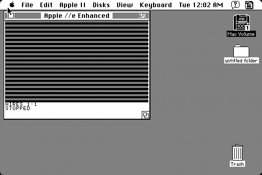 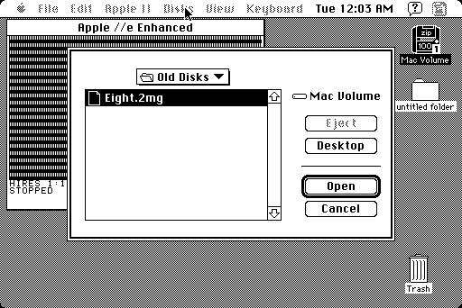
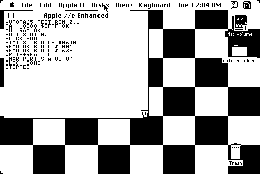 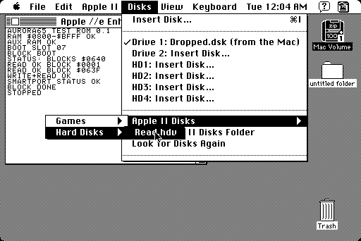
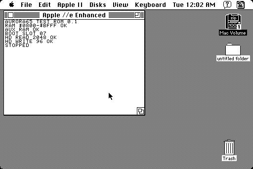 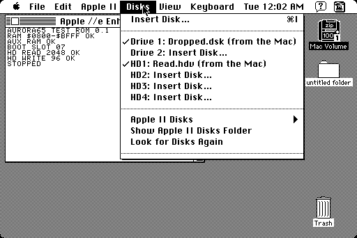
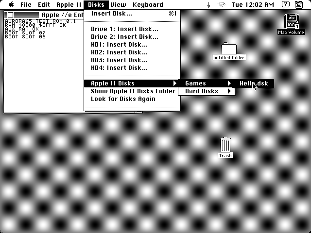 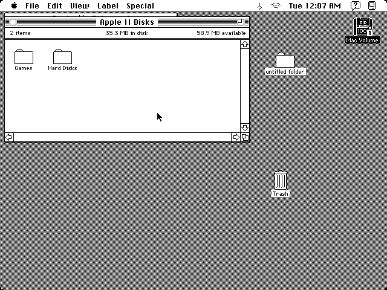
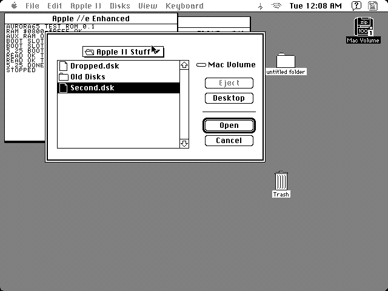 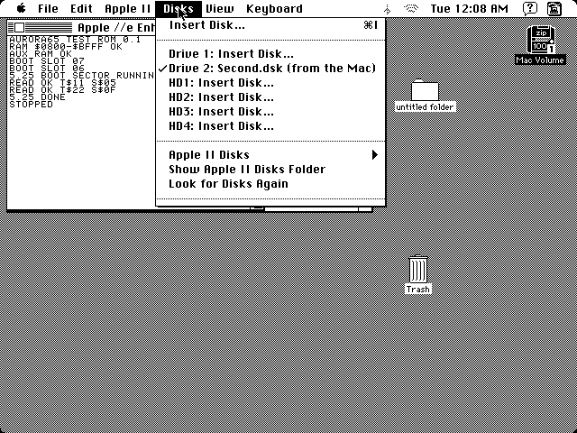

## Drawn over another window (24 November 2026)

The owner's SE, on its 2560 x 1440 HDMI screen: the Apple II window open, the Apple at its BASIC prompt being typed into,
the Finder in front. He dragged a Finder window ("Utilities") so that it covered part of the Apple's window. Afterwards a
rectangle of the Apple's screen, four rows of its text (`]PRTINT`, `?SYNTAX ERROR`, `]PRINT "HELLO"`, `HELLO`), stood
inside the Finder's window on top of its white content, and stayed there: the Finder had no reason to draw it again. The
parts of the Apple's window that still showed were right.

**Why.** `draw()` read the window's visRgn once (`psmac_wclip_rgn_ok`, `psmac_wclip_parts`) and then drew each of its
rectangles. On the 2560 x 1440 screen a picture is 1120 x 768 pixels at 32 bits, milliseconds of drawing, and the card's
core can be given to the HDMI sound (`psmac_guest_yield`) or to the other guest between the reading and the drawing.
Meanwhile the Mac, on core 0, finishes the drag: the Window Manager puts the Finder's window in its new place and gives
the Apple's window its smaller region. The picture went on with the region it had read, over the Finder's window. The
PC card (`psmac_pc.c`) drew the same way, made longer still by the sound's turn it takes every 16 rows on core 1
(docs/19 "Drawn over another window"); so does the video decoder card (`psmac_video.c`), which is not changed yet ("Not
done yet").

**Seen in QEMU, with help** (the solo board, System 7.1, the 1024 x 768 one-bit screen, Aurora65's test ROM and our own
`tools/a2card_print.s`, a boot sector that prints a numbered line for ever, so that every picture is the whole window).
QEMU's Pi draws a one-bit picture in about 1.4 ms and its Mac is slow, so the time between the region's reading and the
drawing had to be widened: `a2.guard=off` (the region read once a picture, as before this day) with `a2.racedelay=100`
(100 ms between the reading and the drawing). A drag never showed it, for another reason: QEMU's Mac takes more than a
second for any drag, and while one program drags a window the Mac runs no other, so Aurora68 Apple II's loop stood still
and the card had stopped drawing (`alive`, "When the program goes") well before the drop. A click on the Finder's window
behind the Apple's, which brings it to the front, is quick: the Apple's rows came out inside the Finder's window and
stayed there while the Apple's own window scrolled on. The owner's quick drag on the SE ended inside the second;
`a2.alivems=10000` stands for it in the testbed, and lets the drags race too.
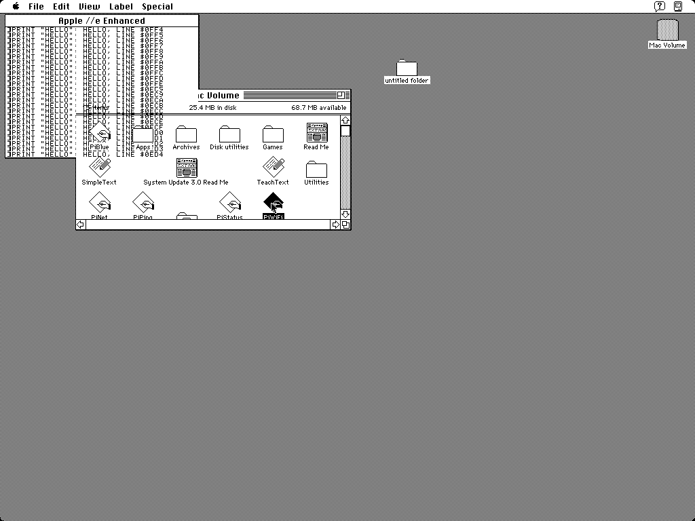

**The cure, in two layers** (`psmac_wclip.c`, "the overdraw guard", shared with the PC card):
1. *The region looked at again.* The region's fingerprint (its handle's master pointer, `rgnSize` and a checksum of its
   bytes) is read with its rectangles, and again before every band of 16,384 pixels (29 rows of the 560-pixel picture, 57
   of the 284-pixel one: a few hundred microseconds of drawing on a Pi 3), and once more at the picture's end. When it
   differs the picture is given up, and the whole window drawn again at the next turn with the region it has now.
2. *What was drawn anyway, painted again.* A band begun just before the Mac changes the screen can still land on another
   window (the change can come between a look and the band's last pixel, and the Window Manager may paint before it
   rewrites the region). So each band is noted, in the screen's pixels, before it is drawn. At every turn of the core's
   loop the card compares the region (and the window's place) with the one the notes were drawn with; when it changed,
   what the pictures drew in the last 200 ms (`REPAIR_MS`), or by a picture that saw the change itself, less the region
   the window has now, goes to the program as a repair request at `A68A_OFF_REPAIR` (`psmac_repair.h`: up to 16
   rectangles under a sequence lock; the program's `repair_done` says it was carried out). Aurora68 Apple II 1.3 carries
   it out at every beat of every loop it runs, in the background too (`mac/a68pc/repair.h`, shared with Aurora68 PC 1.3):
   the rectangles made global through their screen's `gdRect`, less the window's own visRgn, inside GrayRgn (so never
   the menu bar), then **PaintBehind** from the frontmost window of all. PaintBehind (Inside Macintosh I, "The Window
   Manager") erases each window's part of the region and gives it an update event, whichever program it belongs to,
   and paints the desktop's part again; the screen savers' way of giving the screen back. Under System 7 WindowList holds
   only the current program's windows (docs/13 "Windows"), so the program starts from the root layer's first child,
   the layer holding every program's layer front to back, found by climbing from the current layer ($A90) by the
   parent links; under System 6, or if the layers do not hold together, from WindowList.
   The price: when a window is moved over the Apple's while it draws, the newly covered part of that window is erased
   and drawn once more by its own program, a flicker once per move; an Apple that is not drawing costs nothing.

**Tested.**
- On the host (`tools/a2card_test.sh`, run `cover-32` and `cover-8`; `tools/pccard_test.sh` the same for the PC):
  `@cover:1` and `@cover:2` ask for a whole picture and at its second band do what the Mac did on the owner's SE: paint
  a pretend Finder window over the right half of the window below its first 40 lines and give the window an L-shaped
  region, rewritten in place in the same block. Before the band's look: the picture given up, nothing drawn over. Just
  after: the band lands on the Finder's window (5,040 pixels on the 32-bit screen), one repair request for exactly that
  part (the rectangle 296,80-576,98: the band's rows 69-98 less the 40 lines left uncovered), the pretend program paints
  it, and nothing of the Apple's is left there; the part still visible drawn, nothing outside the window. With
  `a2.guard=off` (`cover-old-32`) the same change leaves 96,095 of the covered part's 96,320 pixels the Apple's: the
  leftover. 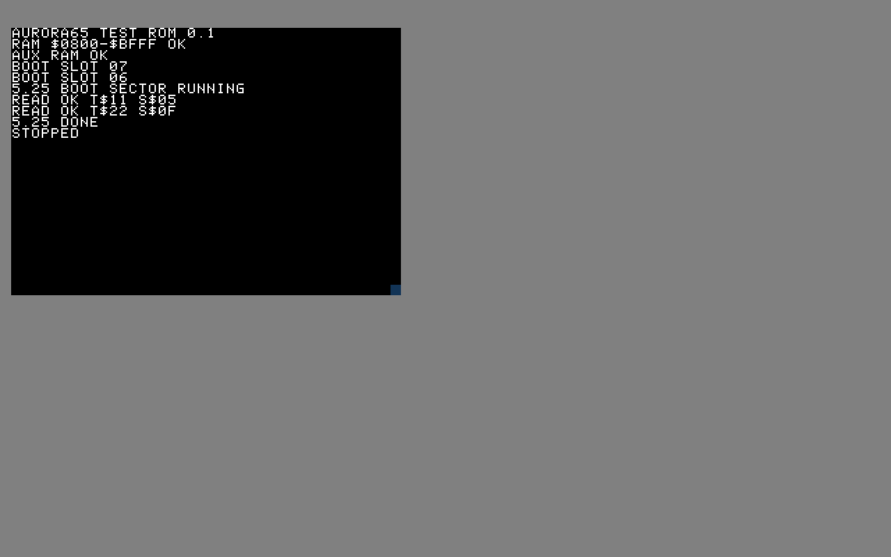
- In QEMU (the run above, now with the cure; `a2.racedelay=100 a2.alivems=10000`, 1024 x 768): the Finder's window opened
  next to the Apple's, dragged over it, away and back four times, the Apple's window and the Finder's brought to the front
  in turn, the Finder's dragged over the Apple's top left three times, the Apple's window grown and zoomed back (the
  desktop where it had been); 31 pictures given up, 19 repair requests (25 rectangles), every one carried out by the program
  (`[A2] Aurora68 Apple II had the Mac paint it again`), and nothing of the Apple's outside its window in any of the
  screenshots, the Finder's windows and the desktop drawn again by the Finder and the Window Manager. This is also the
  check that PaintBehind from the layers' root paints another program's windows under System 7.1 while Aurora68 Apple II
  is in the background (the Finder in front), and the desktop.
  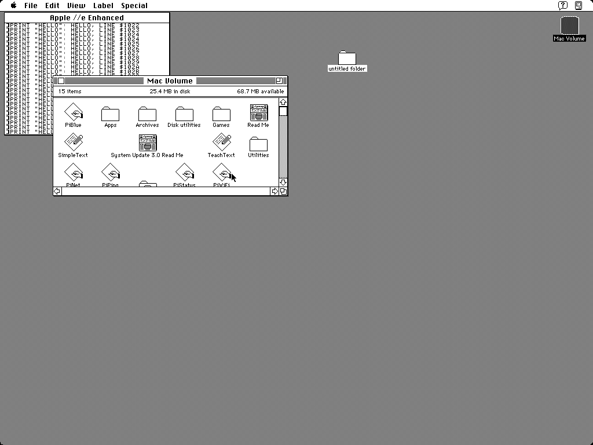 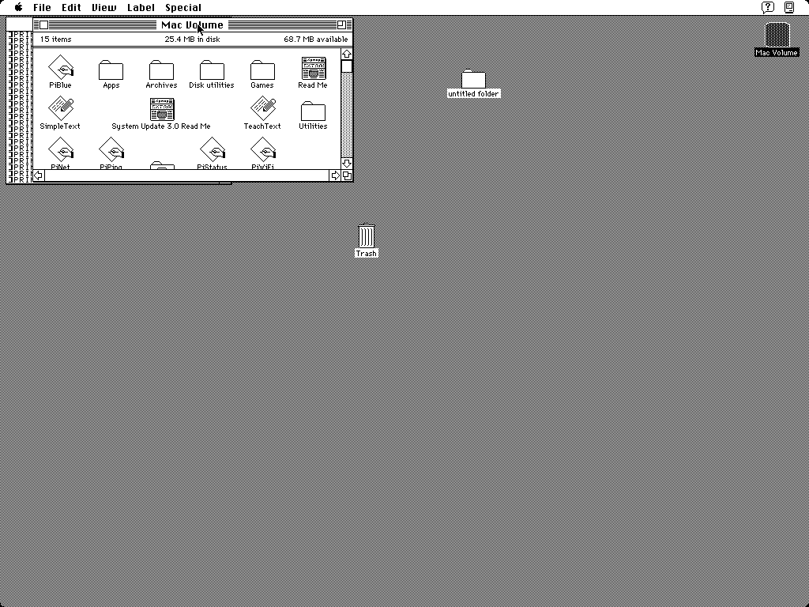
  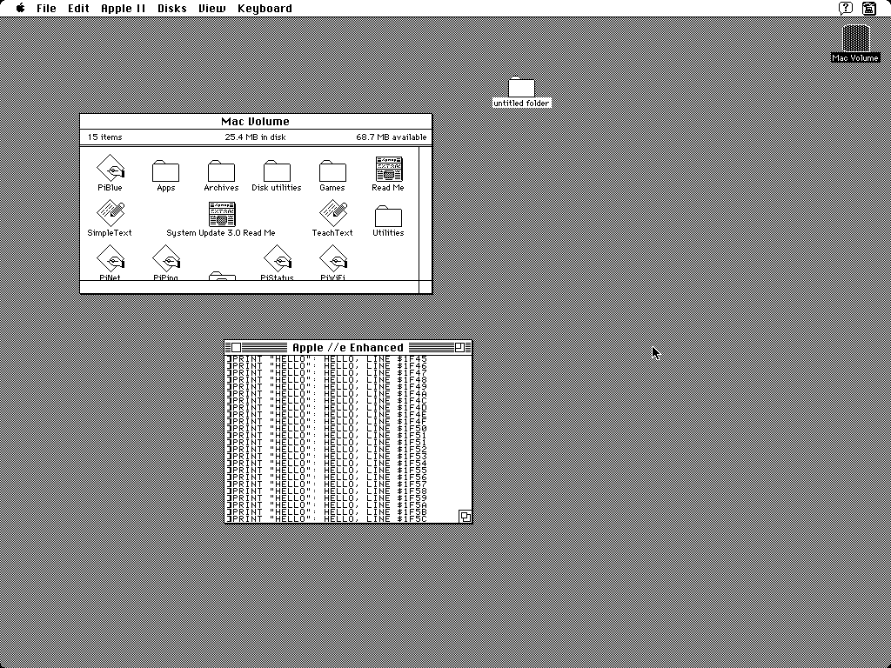
- In QEMU at 512 x 342, first with `a2.guard=repair a2.racedelay=100 a2.alivems=10000` (the looks between bands left out,
  so that whole pictures were drawn with a region that changed under them and the second layer alone had to clean up):
  the Finder's window opened beside the Apple's, the two brought to the front in turn three times, the Finder's dragged
  over the Apple's three times; 11 pictures saw the region change by their end, 6 repair requests, every one carried
  out, nothing of the Apple's left outside its window. Then with no testbed option at all, as the owner runs it: the two
  windows brought to the front in turn four times and dragged; 1 picture given up, 19 repair requests (18 of them for
  pictures drawn within the 200 ms before a change that looked unchanged throughout: the price above), every one
  carried out, no leftover. Some requests were for the whole window: the card read the Apple's region empty for a moment,
  apparently while the Process Manager brought a layer to the front; the program takes away what its window shows by
  then (DiffRgn), so only the newly covered part of the Finder's window was painted again.
  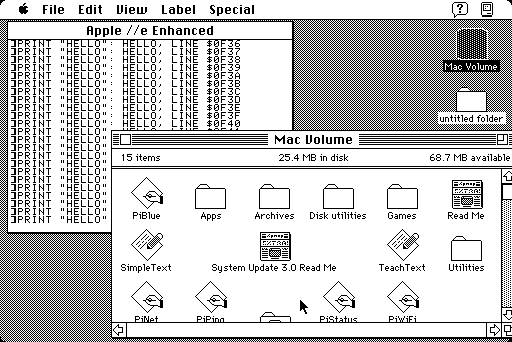 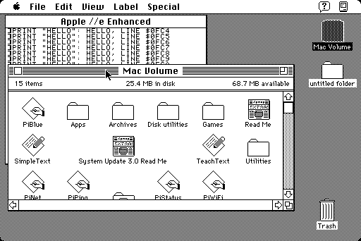
  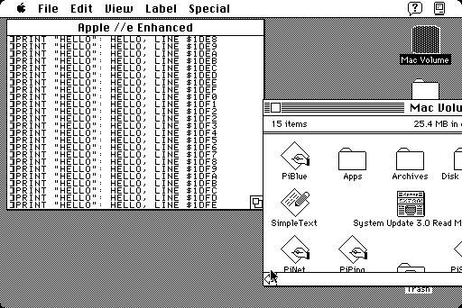

## How it was tested (23 November 2026)

- **The rule**, `tools/guest_test.c` (in `make -C mac check`): `psmac_guest.c` with two pretend guests, turn by turn: the
  PC in front and both always ready gives 700 turns of 800 to the PC and 100 to the Apple with `guest.floor=1`, 800 and 0
  with 0, 400 and 400 with 4; the Apple in front the other way round; a front guest not ready leaves every turn to the
  other; neither in front, by turns; neither ready, nothing.
- **On the host**, `tools/a2card_test.sh` (in `make -C mac check`, skipped without `AURORA65_DIR`): `psmac_a2.c` itself with
  Aurora65's x86-64 library and the scheduler, drawing into a pretend Mac screen, typing into the ring as the program does,
  only Aurora65's own test ROMs and images and two boot sectors of our own (`tools/a2card_hires.s`, `tools/a2card_80col.s`,
  assembled with Aurora65's assembler):
  the enhanced IIe booting Aurora65's 5.25" test disk on the SE's 512 x 342 screen and `HELLO APPLE` typed and echoed;
  hires at 1:1 with **every one of its 44,800 pixels** checked against the Apple's memory; the same scaled to 420 x 288;
  hires in colour on a 32-bit screen at twice its size (1120 x 768); 80 columns from the cells at 6 x 8; the II+ (lowercase
  typed, uppercase echoed); a block image written by the Apple's boot block and **written back into its file** ("A65W"
  and the block's number found in it afterwards); the Disks menu's attach into HD1, a cold start booting it, the eject;
  a change of model to the II+ and back refused for the IIc ("No ROM for the Apple //c"); no ROM at all refused with the
  reason; the speaker's samples (the test ROM's beep). With `AURORA86_DIR` too, both cards through the scheduler, each in
  front in turn, `guest.floor=1` and 0 (the PC starting FreeDOS 1.4's installer, which mostly waits: the PC was
  idle most of the time and the Apple kept 992-1000 per mille of its own speed in all four; the rule with a PC that never
  idles is what `tools/guest_test.c` checks).
  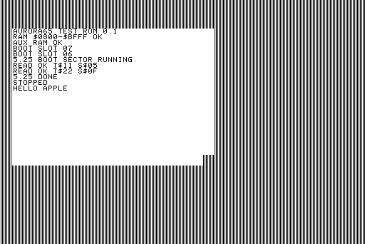 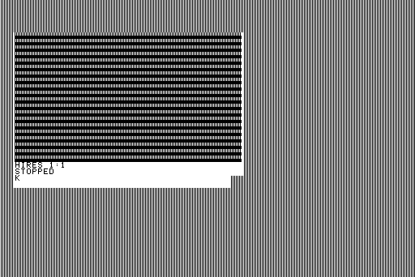
  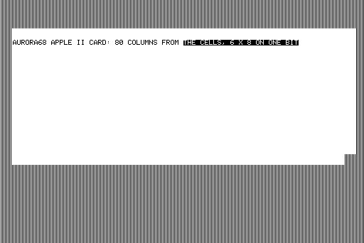 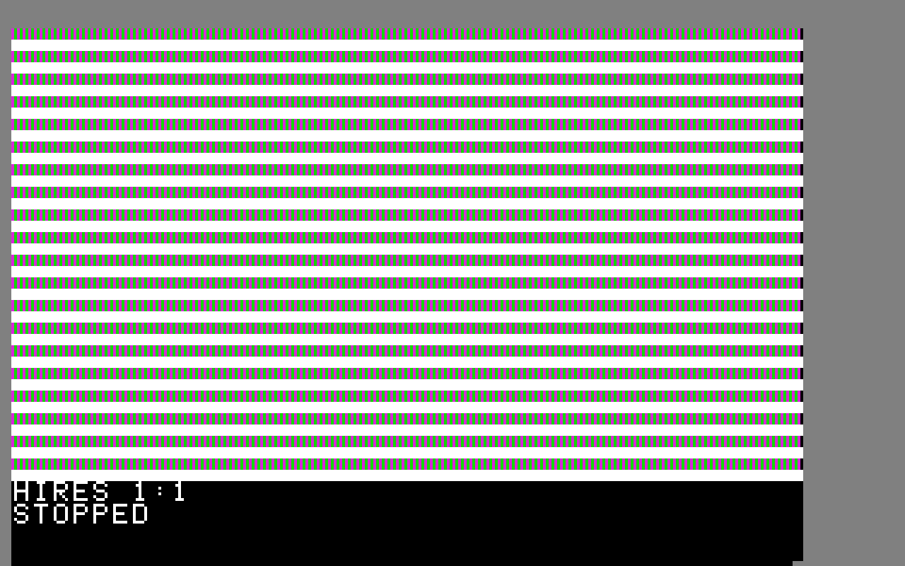
- **In QEMU**, the solo board with System 7.1 (the Apple II kernel with the PC card too, `a2=on pc=on`, the files through
  semihosting, Aurora68 Apple II and Aurora68 PC in Startup Items, QEMU's USB keyboard and mouse moved through its
  monitor). At **640 x 480**: both cards on core 2, the PC's window in front at first; the PC's window dragged aside and a
  click bringing the Apple's to the front (the heartbeat's `[GUEST]` line: "Apple II on core 2 (front)"), `hello A2`
  typed into the Apple; the Disks menu (test.dsk checked "in drive 1") ejecting test.dsk and putting hires.dsk into
  drive 1; Apple II > Restart Cold and the hires picture at 1:1; a click on the PC's window bringing it in front over the
  Apple's ("PC on core 2 (front)"), each card drawing only in its own window's visible region. The Apple at 1000 per mille
  of its own speed beside the PC once both had started (in the first seconds, while the PC read its 12 MiB firmware and
  the Mac started, it fell behind and dropped the time, as designed).
  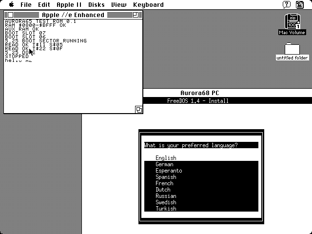 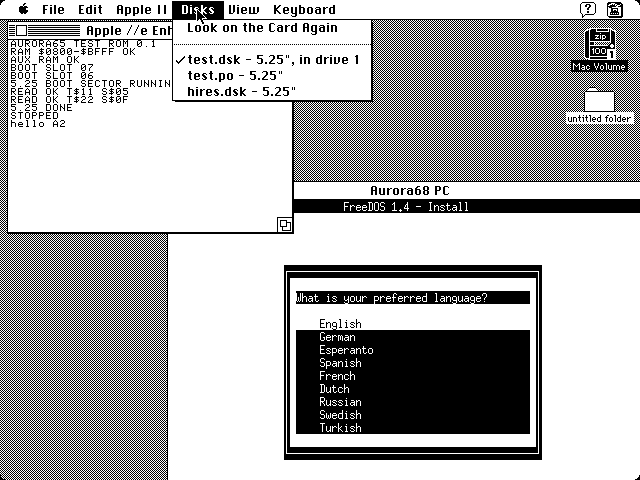
  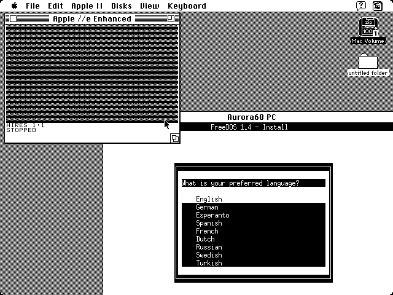 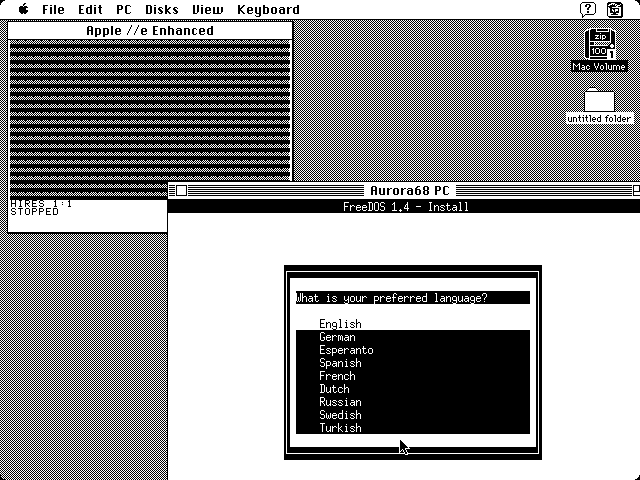
  At **512 x 342**: the window and its menus fitting the SE's screen; the Disks menu putting `test.hdv` (a 4 MB block image)
  into HD1; Shift-Control-Command-Delete restarting cold; the Apple's boot block writing its block ("WRITE+READ OK") and
  the card writing it back into the host's file 2 s later (`[A2] test.hdv: 1 sector written back to the host's file`; "A65W"
  and block $1FFE found in the file); the pointer's box drawn once the pointer moved; View > Scaled to the Window with
  the window grown.
  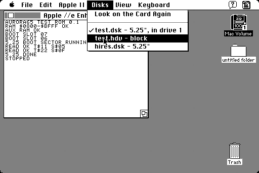 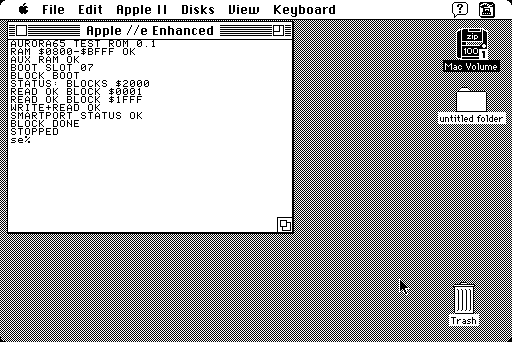
  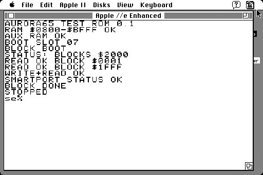
  A second run at 512 x 342 with both programs, after the menu fix below: the Apple's window brought in front of the PC's,
  hires at 1:1 with View > Actual Size (1:1) enabled and checked, View > White on Black, Aurora68 PC's Keyboard item
  enabled. 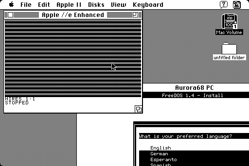 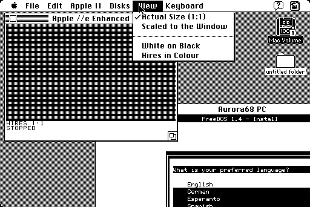
  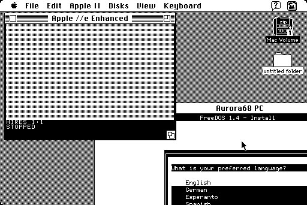 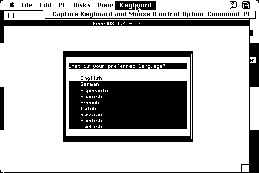
- **Found in QEMU**: AppendMenu takes "(" anywhere in an item's words as "disabled", so "Actual Size (1:1)" and the
  Keyboard menu's item came up dimmed; Aurora68 PC had the same with "Large Text (8 x 16)" and "Capture Keyboard and Mouse
  (Control-Option-Command-P)" since its first version. Both programs give such items their words through SetItem now.
- **The normal kernel**: built from main and from this branch, outside git, in the same place, with the same
  `SOURCE_DATE_EPOCH`: the same `Emu68.img` byte for byte.
- **Found by the test**: Aurora65's test ROM had three `nop`s where one was meant before its fixed `jmp boot525`, so its
  documented `stop` entry ($F813) was the middle of that jump, and a boot sector that ended with `jmp $F813` went back to
  scanning the slots ("5.25 DONE", then "BOOT SLOT 05 ... NO BOOT DEVICE"); fixed there (Aurora65 commit "Test ROM: stop
  at $F813 as documented").

## Options

| Option | What |
|---|---|
| `a2=on` | the card in slot $E and the Apple started with the Mac (off by default; only in a kernel built with `-DPSMAC_A2=ON`) |
| `a2.model=` | `iie-enhanced` (the default), `iie`, `iiplus`, `ii`, `iic`; without it, the model of the ROM found |
| `a2.rom=NAME` | the start model's ROM in the card's root (by default by the model: `apple2e-enhanced.rom`, `apple2e.rom`, `apple2plus.rom`, `apple2.rom`, `apple2c.rom`) |
| `a2.p5=NAME` | the Disk II's boot PROM, 256 bytes (`disk2-p5.rom` by default) |
| `a2.d1=NAME`, `a2.d2=NAME` | 5.25" images in the Disk II's drives (slot 6) |
| `a2.hd1=NAME` ... `a2.hd4=NAME` | block images in the block cards' units (slot 7: HD1, HD2; slot 5: HD3, HD4) |
| `a2.d1ro=on` ... `a2.hd4ro=on` | that image read only: its changes stay in memory |
| `a2.core=1\|2` | the Pi core: the PC card's by default (2 on the solo board, 1 elsewhere) |
| `guest.floor=0..4` | eighths of the turns a busy front machine leaves to the other on a shared core (1 by default) |
| `a2.img1=PATH` ... `a2.img8=PATH` | testbed only: more images in the Disks menu (semihosting cannot list a host directory) |
| `a2.testwin=S,L,T,R,B` | testbed only: the window's place set by the kernel |
| `a2.textlog=1` | testbed only: every changed line of the Apple's text screen into the log, `[A2] \| text` |
| `a2.guard=off`, `a2.guard=repair` | testbed only: the region read once a picture and no repairs, as before 24 November 2026; or the repairs alone, without the looks between bands ("Drawn over another window") |
| `a2.racedelay=MS` | testbed only: MS (up to 500) between a picture's look at the region and its first band, so that the Mac's changes land in the middle of pictures |
| `a2.alivems=MS` | testbed only: drawing stops when the program's loop stands still this long (1000 by default); QEMU's slow drags hold every other program's loop for more than a second |

## What the owner copies to the SD card

A kernel built with `-DPSMAC_A2=ON -DAURORA65_DIR=...` (and `-DPSMAC_PC=ON` for both cards) as `kernel8.img`; `a2=on` in
`cmdline.txt`; the ROM dump of your own machine as `apple2e-enhanced.rom` (or the other names above; `tools/romcheck.py` in
Aurora65 says which ROM a dump is); the Disk II's P5 PROM as `disk2-p5.rom` for 5.25" disks; disk images in the root (they
appear in the Disks menu, or name them with `a2.d1=` ...); Aurora68 Apple II on the Mac. The Apple writes into its images:
keep copies elsewhere, and use Apple II > Power Off before switching the Pi off.

## Not done yet

- **Disks from the Mac** (24 November 2026): not run on the owner's SE, with a real AppleShare volume (Lagoon) or a
  floppy; Finder drag and drop itself was not made in the testbed (the agent's `open`, which sends the same Open
  Documents event, was); System 6 (AppParmHandle, no Apple events) not run. While a menu is held down or a window
  dragged, the Apple's hard disk waits (the program's loop does not turn). A hard disk's changes not yet sent are lost
  if the program dies (the log says how many).

- **Drawn over another window** (24 November 2026): not run on the owner's SE or on a deep (32-bit) screen in QEMU (the
  host test's runs are 8 and 32 bits); System 6 not run (the program starts PaintBehind from WindowList there). The
  video decoder card (`psmac_video.c`, Aurora68 Play and Aurora68 Video) has the same pattern, the region read once a
  picture, and is not changed yet. Read from how the Window Manager drags, not seen: during a drag of under a second the
  card goes on drawing and may draw over the dragged window's gray outline where it crosses the Apple's window; the
  Window Manager takes the outline away by drawing it once more, which can leave an inverted line in the Apple's picture
  until those rows change.

- **Sound** goes to the Mac's sound output as its sixth source (`psmac_audio.c`, "source 6": HDMI, the jack, or
  `mac.audiodump=`), not to the SE's own speaker yet; heard nowhere yet but in the host test's samples.
- The SE board, the IIci testbed, real hardware, the SD card path (only semihosting was run), the owner's Apple ROMs
  (only Aurora65's test ROMs were used), the Disk II writing (Aurora65's test disks only read 5.25" images), the IIc's
  own hardware and the IIgs (Aurora65's P5 and later), MouseText (Aurora65 draws a checked box).
