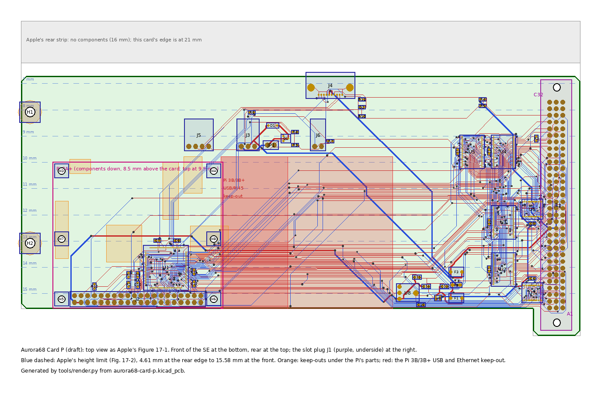

<!-- SPDX-License-Identifier: MPL-2.0 -->
# Aurora68 Card P: a Raspberry Pi 3A+ in the Macintosh SE's processor direct slot

*24 November 2026, first draft; placement reworked 25 November 2026 (the CPLD beside the Pi's header, the Pi 3B/3B+
keep-out widened, 3D models).* A KiCad 8 design for **Card P** of docs/22 section 5.1: a card for the SE's 96-pin
processor direct slot (PDS) that carries a Raspberry Pi 3A+ on its 40-pin header and does what the classic PiStorm
does in the 68000's socket, through the slot instead. The SE's own 68000 stays in its socket; the card takes the
bus from it with /BR, /BG and /BGACK and can hand it back ("stock mode"). The Pi runs Aurora68's kernel unchanged:
the card speaks the classic PiStorm's GPIO protocol (`PROTOCOL.md`). The bus half (CPLD, latches, bus switches,
power, slot plug) is laid out in the right-hand 110 mm of the card, so that a Compute Module card (Card M) can
reuse it.

## Status: a draft for a hardware designer to review

- **Not reviewed** by anyone who builds hardware. **Not built.** **KiCad's ERC and DRC have not been run**: KiCad
  is not installed where the files were made. They were generated by Python from `tools/design.py`, read back
  and checked by `tools/validate.py` (below), which is no substitute.
- **Routed by Freerouting, not by a person** (see "Routing"): 137 of 139 nets complete, 2 connections open; treat
  the copper as a starting point.
- **The CPLD logic is simulated, not synthesised**: Icarus Verilog against a behavioural SE, 154 checks pass
  (`rtl/README.md`); Quartus has not fitted it, so whether it fits an EPM240 is an estimate (154 LUTs and 122
  flip-flops by yosys: probably yes, without much room; the board takes an EPM570 in the same footprint).
- Several mechanical facts are our reading of Apple's drawings and need a real SE with its chassis and a ruler:
  the height limit's direction, the plug's exact position, the Pi's stack (sections below).

## What is on the card

| Ref | Part | Why |
|---|---|---|
| J1 | 96-pin DIN 41612 type C plug, male, straight, press-fit, **on the underside** | the slot (Apple, *Designing Cards and Drivers*, 3rd ed., Figure 17-4) |
| U1 | EPM240T100C5N (or EPM570T100C5N), as the PiStorm | the bus cycle, arbitration, stock mode, fan, status (`rtl/aurora68_pds.v`) |
| U2-U5 | 74LVC16373 x4, as the PiStorm | address (A1-A23) and data latches, write and read, 5 V tolerant |
| U6, U7 | SN74CBTD3384 x2, as the PiStorm | the strobes, function codes, /DTACK, /VPA, /BERR, E, /VMA, interrupts, /RESET, /PMCYC and the arbitration lines between the slot and the CPLD |
| U8 | AMS1117-3.3 (the PiStorm's LM1117-3.3) | 3.3 V for the CPLD and latches |
| F1, U9 | 1.1 A polyfuse, LM66100 ideal diode | the slot's +5 V to the Pi and the card; a Pi also powered from its own USB never feeds the SE |
| J2 | 2x20 socket, 6.0 mm | the Pi 3A+ (or Zero 2 W), plugged in components-down |
| J3, Q1, D1, R8, R9, F2, JP1, R6 | fan header, MOSFET, flyback diode, gate resistors, 0.35 A polyfuse, full-speed jumper, tachometer pull-up | docs/22 section 6 |
| J4, F3, R11 | 10-way 1.0 mm FFC connector, 0.75 A polyfuse | the cable to a connector card at the rear (Apple's Figures 17-2, 17-7, 17-8): USB, +5 V for it, the stock switch, an LED |
| J5 | 4-pin header | USB from the Pi 3A+'s USB-A socket (a short plug pigtail), on to J4. Its VBUS pin is deliberately not connected |
| J6, R7 | 2-pin header, pull-up | stock mode: a jumper, or a switch on a cable (the same signal goes to J4) |
| D2, R10 | LED | activity |
| R1-R5, C1-C16 | as the PiStorm where it has them | JTAG pull-ups (4.7 k on TMS and TDI), 22 ohm on the 68000 clock C8M (R3), the SE power sense (10 k / 15 k), decoupling |
| R12 | 22 ohm | GPCLK0's series resistor at the source, beside the Pi's pin 7 (new on 25 November) |
| H1, H2 | 3.86 mm holes | Apple's card supports (Figure 17-1) |
| H3-H8 | M2.5 holes | the Pi's standoffs (3A+: four; Zero 2 W: two more) |

The full list with values, LCSC numbers where known, heights and notes is `bom.csv`. The netlist is the
schematic: `aurora68-card-p.kicad_sch` and its five sheets (slot and bus switches, CPLD and latches, Pi socket,
power, fan/LED/switch/rear cable), pictured in `img/sch-*.png`.

## How it follows the PiStorm, and where it departs

The owner's rule for Card P: as simple and as close to the PiStorm Rev B as possible, cheap to make. So the
circuit is the Rev B's (reference/pistorm: `Pistorm_Rev_B-1.pdf`, the Altium files, the BOM): the same CPLD family
and package wired the same way for an EPM240 or EPM570, the same four 74LVC16373 latches, the same two CBTD3384
bus switches carrying the same 68000 control signals, the 22 ohm resistor on the CPU clock, the 3.3 V LDO with
22 uF in and out, 4.7 k pull-ups on TMS and TDI, 100 nF per IC, the Pi's GPIO 0-27 used exactly as there, the Pi
plugged in components-down over the card as it hangs over the logic board on a PiStorm, and **every CPLD pin of
every signal the PiStorm has on the PiStorm's own pin number** (`rtl/aurora68_pds.qsf`, checked against the Rev B's
`pistorm.qsf`; the Pi header's nets checked against the Rev B schematic by reading its Altium file). Departures,
each for a reason:

| # | Departure | Reason |
|---|---|---|
| 1 | A 96-pin DIN plug on the underside instead of the 68000 DIP-64 plug | the slot |
| 2 | CPLD pin 53 (E) is an input, 71 (/BG) an input, 69 (/BR) and 70 (/BGACK) open-drain outputs, 68 (the PiStorm's /HALT) is /PMCYC; 51, 99, 100 (CLK_SEL, C1, C3) unused; new: 77 SE power sense, 78 fan PWM, 81 tachometer, 82 stock switch, 83 LED | the slot card's roles are the other way round: the 68000 is still there, so the card requests the bus instead of granting it and follows the 68000's E; on the SE /HALT is /RESET, so its pin is free |
| 3 | The read timing needs **transparent** latches (74LVC16373) | the new cycle opens the read latch on /DTACK and closes it where a 68000 latches (docs/18 C2). Note: the Rev B BOM in reference/pistorm lists SN74LVC16374 (edge-triggered) although the archive is named "..._74LVC16373": with a '16374 this card would latch at the wrong edge |
| 4 | +5 V through a polyfuse and an LM66100 ideal diode (the PiStorm takes the socket's 5 V straight) | the brief: a Pi on its own USB must not back-feed the SE. A Schottky is simpler but drops 0.35-0.45 V at the Pi's current, putting a Pi 3A+ at or under its 4.63 V under-voltage threshold on an old SE supply (docs/12, "Power through the socket"); a single P-MOSFET with its gate grounded blocks reverse polarity but conducts both ways once on, so it does not stop back-feeding. The LM66100 is one SC-70 part |
| 5 | CBTD3384 VCC from the protected 5 V (5V_PI) | the switches must be off when the card is unpowered, and powered whenever the CPLD is |
| 6 | VCCINT tied to 3.3 V directly | the PiStorm links it through a 0 ohm resistor beside an unfitted 1.8 V regulator option; only MAX II "G" parts would need it |
| 7 | 0603 resistors and capacitors, 0805 for 10 and 22 uF (the PiStorm uses 0402 and 0603) | the owner's assembly preference |
| 8 | Added: the SE power sense (2 resistors), the fan circuit, the FFC to the rear connector card with its fuse, the USB-in header, the activity LED, the stock jumper | docs/22 sections 4 and 6 |
| 9 | Not a departure from the PiStorm but from the brief: the slot's control signals reach the CPLD through the CBTD3384 switches, not through 74LVC buffers | the owner's rule. Apple asks for buffering when a card loads a line with more than two 74LS inputs and 30 pF, or more than about 2 inches of trace. Each control line here sees one CMOS input (the CPLD, about 10 pF and 10 uA), the switch (about 5-10 pF on), and a short trace: a few uA of DC load against two LS loads' 40 uA / 0.8 mA, and, since the placement rework put the CPLD beside the Pi, a CPLD-side trace of up to about 180 mm: roughly
| 10 | R12, 22 ohm in series with GPCLK0 (GPIO 4) at the Pi's pin | asked for with the placement rework: source termination for the 200 MHz clock. The PiStorm wires GPIO 4 straight to the CPLD; fit 0 ohm to match it. It is the only schematic change of the rework |
| 11 | The CPLD sits under the Pi, beside its header | as on the PiStorm, where the Pi sits over the CPLD: short GPIO lines (section "Placement") |
0.4 pF/cm for a 0.15 mm trace over the ground pour, so some 7 pF, plus the switch's 10-12 pF and the CPLD pin's 8-10
pF, about 25-30 pF in all against Apple's 30 pF (C8M, with 20 pF allowed and no switch, sees about 16 pF). That is at
the limit: the reviewer's to confirm, with 74LVC buffers near J1 as the remedy (section "Placement"). Address and data go through the latches, which are real buffers. The CBTD's level shifting brings 5 V signals down to about 4.3 V at the CPLD (the PiStorm runs that way; the MAX II's absolute maximum input is 4.6 V) |

## Placement (25 November 2026)

The first draft had the CPLD next to the latches by the slot plug, about 95 mm from the Pi's header: every GPIO,
GPCLK0's 200 MHz clock among them, crossed most of the board. On the PiStorm the Pi sits right over the CPLD. So:

- **U1 (the EPM240) is under the Pi, beside its header**, in the one pocket the keep-outs under the Pi's own parts
  leave big enough for a TQFP-100: between the SoC's keep-out (x up to 46.0) and the USB socket's (from x 64.5,
  Raspberry Pi's drawing putting the USB-A body at u 53.1-65.9), from the camera connector's keep-out to just behind
  the socket (U1's courtyard x 46.6-63.9, y 85.8-103.1). Rotation 0 puts its pins 1-35 (all the Pi's signals)
  facing the header and its pins 51-76 (the 68000 side) facing the slot plug. It is 1.6 mm tall in an 8.5 mm gap;
  the Pi's own small parts above it leave more than 4 mm. Its six decoupling capacitors and the JTAG pull-ups sit
  around it, also under the Pi; `validate.py` allows parts of up to 6.0 mm under the Pi, outside the keep-outs.
- **GPCLK0** goes from the Pi's pin 7 through R12 (22 ohm, right at the pin) to U1's pin 12, routed first and by hand
  on the top layer (a 45-degree run and a straight run, 0.25 mm), 26.8 mm in all. `validate.py` fails if it grows
  past 30 mm. Six bottom-layer tracks (GND, JTAG_TMS, PI_A0, PI_D1, PI_D2, PI_D9) cross under it, each a short jump:
  its return is the bottom layer's pour, broken where they cross.
- **Pi-to-CPLD lengths, routed** (`validate.py` check 12d, all from the Pi's socket pin to the CPLD pin): GPCLK0
  26.8 mm; the data and strobes PI_D0-PI_D15, PI_A0/A1, PI_RD, PI_WR, PI_TXN_IN_PROGRESS, PI_IPL_ZERO, PI_RESET from
  4.5 to 43.2 mm, 20 of 23 under 34 mm, the longest PI_A0 43.2, PI_A1 38.8 (both from the far end of the header)
  and PI_D15 35.4;
  JTAG up to 51.6 (TMS; JTAG is slow). The straight-line distances are 4-27 mm; Freerouting's detours add the rest.
- **The bus half stays by the slot plug**: the four 74LVC16373 and the two CBTD3384 with their decoupling, every slot
  signal within 41 mm of its plug pin as before.
- **What got longer**, and it matters more than the brief assumed: the CPLD-to-latch nets reach **259 mm** (PI_D7 to
  U4) and the CPLD-to-switch nets **184 mm** (M68K_IPL_n1). The switch side runs at 68000 speed. **The latch side
  does not all**: the PI_D bus is the Pi's own data bus, shared by the socket, the CPLD and the four latches, and
  the latch strobes LTCH_A_*, LTCH_D_WR_* and LTCH_D_RD_OE_n are combinational copies of the Pi's write and read
  strobes. Those carry the Pi's fast register transfers, now over 20-26 cm of unterminated 0.15 mm trace. The
  timing is not the worry (about 1.7 ns of flight), the edges and ringing are; on the PiStorm the latches are a few
  cm from the Pi. Options for the reviewer: slow output slew on those CPLD pins, series resistors at the CPLD, or
  the latches moved beside the CPLD (making their slot-side traces long instead, where the latches drive the bus and
  the read latch loads it). And on the switch side every extra cm adds to the SE's own lines through the CBTD3384
  (departure 9). The middle of the card, where the CPLD used to be, is now free for the bus routing.

## The slot plug: position and orientation

From Apple's Figure 17-1 (card, top view) and Figure 17-5 (logic board): the card-support holes are at x = 3.43 mm,
50.17 mm apart, the lower one 25.09 mm above the card body's front edge (y = 85.02 mm, with y measured from the rear
edge of Apple's maximum outline); the plug's centre line is 200.66 mm to the right of the holes (x = 204.09) and its
centre 14.61 mm above the lower hole (y = 70.41). Figure 13-1 shows the logic board's socket J13 from above with row C
towards the rear I/O ports' side, row A towards the logic board's edge and pin 1 towards the SIMMs (the front); Figure
17-1 marks pins 1A, 1B, 1C at the plug's front end, row A outermost. So, seen from above the card (and through it):
**row A at x = 206.63, row B at 204.09, row C at 201.55; pin n at y = 70.41 + (16.5 - n) x 2.54, so pin 1 at
y = 109.78 (front) and pin 32 at y = 31.04 (rear).** `tools/check_pinout.py` checks all 96 pads against this, and
every pin's name and net against `se-pds-pinout.csv`. The plug's fixing holes (2.85 mm, 90.0 mm apart, Figure 17-4)
are placed 0.3 mm from row B towards row A, which is our reading of a 0.3 dimension on the figure.

Because the plug is on the underside, its footprint is placed on B.Cu. In the board file its pads are at their
physical positions; the library copy of the footprint is its mirror image, as KiCad expects of a footprint drawn
from the top. **After any "update footprints from library" in KiCad, re-run `tools/check_pinout.py`** (or check
that pad A1 is at the front right, under the silkscreen's "A1").

**`se-pds-pinout.csv`** is the single source for the pinout: row, pin, signal, direction (the logic board's, as
in Apple's Table 13-1), notes (loading, pull-ups). It was transcribed from the OCR of Table 13-1 and Figure 13-1
and checked against docs/22's table; the script compares the two on every run.

## Height: which end is high, and the Pi

Apple's Figure 17-2, "Side view height restrictions", gives **15.58 mm at one end and 4.61 mm at the other**. Read
against Figures 17-3, 17-7 and 17-8, that side view is drawn **from the side of the machine**: its horizontal axis
is front to back (the card in it is the 110 mm body, to scale with the logic board's depth, not the 213 mm length),
the rear housing with the connector card is at its right-hand end, and the 4.61 mm is at that end. So:

- **The height limit falls from 15.58 mm at the card's front edge to 4.61 mm at its rear edge, across the card's
  110 mm depth, not along its 213 mm length.** docs/22 and the brief had assumed "one end of the card"; the
  owner's "more room towards the back of the chassis" is true behind the card (the rear housing), not over it.
  This is our reading of a sketch: **measure a real SE with its chassis in place before ordering.**
- In Apple's drawing the two figures are marked a little outside the card's own front and rear edges, on a straight
  chassis edge. This design takes them as applying at the card's front edge (y = 110.11) and the rear edge of the
  maximum outline (y = 0), linearly between (`design.height_limit`). If the drawing is to scale the real limit at
  the card's front edge could be nearer 13 mm; the Pi's back would then be fine (it is 9.9 mm) but should be
  measured.
- The tall parts are therefore along the **front** edge: the Pi's socket, the fan header, the jumpers. The cable
  connector J4 (2.6 mm FFC) is at the rear, where Apple suggests the cable connector (Figures 17-2 and 17-7) and
  where only 7 mm is allowed. Apple's 16 mm "no components" strip along the rear edge is simply cut off: the card's
  rear edge is at y = 21 mm.
- `tools/validate.py` checks every footprint's height (from `bom.csv`'s Height_mm, the parts' nominal heights)
  against the limit at its rearmost point, and the Pi as a body; `img/heights.csv` lists every margin. **The
  smallest margin is 0.08 mm: the Pi's back (9.90 mm) at its rear edge (limit 9.98 mm).** That is less than the
  parts' tolerances (a 2.54 mm socket's height is typically +-0.2 mm, the Pi's 1.4 mm board +-0.14 mm, its header
  +-0.2 mm), so the real stack must be measured.

### Mounting the Pi: the options

A Pi on a header cannot be "the right way up" and plugged straight into the card: its header's pins point up,
away from the card. The options, with a Pi 3A+ (Raspberry Pi's drawing: 65 x 56 mm, header 8.5 mm high, USB-A
7.0, HDMI 6.5, audio 6.0, camera and display connectors 5.5):

| Option | Stack (mm above the card) | Verdict |
|---|---|---|
| **A. Components down on a socket over the card (chosen)** | socket 6.0, the Pi's header body 2.5, so its components side at 8.5; board 1.4: **back at 9.9**; microSD socket and card +1.6 = 11.5. The USB-A ends 1.5 mm above the card, HDMI 2.0, audio 2.5; the SoC with a 6 mm heatsink 1.1 | fits under Apple's slope if the Pi's rear edge is at least 53.1 mm from the rear of the outline: it is at 53.9, its front edge at 109.9. The heatsinked SoC faces the card across an 8.5 mm gap a fan can blow through: much better than the socket PiStorm's few mm |
| B. The right way up beside the bus half, a short 40-way cable from its header | standoffs 3, board 1.4: components side 4.4; USB-A 11.4; header 12.9; an IDC plug on it about 16 | fails: over 15.58 even at the front edge, and the Pi's 56 mm depth reaches where only 10 mm are allowed; and a ribbon carrying the 200 MHz clock |
| C. Off the end of the card | - | outside Apple's maximum outline |
| D. Its board level with the card, in a window cut in it | the Pi's parts measured from the card's plane | needs a cable from the header (pins up) to the card, a large cut-out, and parts below the card's plane over the logic board; not pursued |

Option A it is, with the Pi **turned over about its long axis**: the header runs along the card's front edge, the
USB socket points right (towards the bus half and J5), the HDMI and audio sockets, which stand out past the Pi's
edge, overhang towards the rear over the card. (Turned over the other way, the header would be at the rear and
HDMI and audio would stand out past the card's front edge.) The socket's pin pattern is therefore the Pi's header
mirrored, as on a PiStorm. **The socket is the part to choose carefully**: 2x20, 2.54 mm, body 6.0 mm, with contacts
open at the bottom so the Pi's 6.0 mm pins seat fully and its header body rests on the socket (if the pins
bottom out first, the Pi sits higher and the 0.08 mm margin is gone). Standoffs: M2.5 x 8.5 mm (or 8 mm and a
0.5 mm washer). **No screw heads or nuts on the Pi's back at its two rear holes** (H3, H4): there the limit is
10.3 mm and the Pi's back is at 9.9; use snap-in nylon standoffs, or fix the Pi only at the front holes.

### Other Pis

| Board | Size | On this card |
|---|---|---|
| **Pi 3A+** | 65 x 56 mm | the target: everything above |
| **Zero 2 W** | 65 x 30 mm | fits: its header lines up with the 3A+'s (same position along the edge, 3.5 mm in); it covers the front 30 mm of the 3A+'s area; two extra standoff holes (H7, H8). Its parts are lower than the 3A+'s |
| **Pi 3B, 3B+** | 85 x 56 mm | **do not fit in the SE.** Their two stacked USB-A pairs (16.0 mm, Raspberry Pi's 3B+ drawing) and RJ45 (13.5 mm) sit at the far end, beyond the 3A+'s 65 mm, and on this card they point down at it: with the 8.5 mm gap they would hit the card by 7.5 mm, so a 3B cannot even be plugged in. On a header riser that lifts the Pi 8 mm or more they clear the card, for use **on the bench, out of the SE** (the Pi's back is then at about 18 mm). |

The owner accepts the 3B's USB stack standing up to **0.42 mm above Apple's 15.58 mm**. That allowance assumes the
Pi's own board at the card's level (option D, or beside the card), with the 16.0 mm stack measured from the same
plane as Apple's limit. It does not rescue a 3B here: in option A the stack adds to the 8.5 mm gap and the Pi's
1.4 mm board (8.5 + 1.4 + 16.0 = 25.9 mm if the Pi were the right way up on the socket, or a collision with the card
components-down); and even at card level the 17 to 21 mm-deep USB and RJ45 blocks would have to lie entirely within
the front 4 mm of the card, the only band where the limit is above 15.16 mm. If a 3B ever lived at card level, the
0.42 mm means its USB shells may touch or press on the chassis above: they are usually at ground, as the chassis
may be, but check it, and measure a real SE with the chassis in place first. `tools/validate.py` reports the 3B
as a warning with these figures; it applies the 0.42 mm allowance to the 3B's USB and RJ45 only, and to nothing
else.

Even so the card keeps everything a 3B's ports can occupy clear for bench use (widened on 25 November 2026, after
the owner saw the fan, USB and stock headers standing where a 3B's USB pair and RJ45 would be):

- **The keep-out, PI3B_EXT: x 76.3-141.8, y 51.9-110.1** (to the card's front edge). It covers the 3B's board beyond
  the 3A+'s outline, its USB pairs and RJ45 including their 2.4-2.8 mm overhang past the board's edge (Raspberry Pi's
  3B+ drawing: USB at u 69.3-87.8, RJ45 at u 65.8-87.4), **40 mm in front of the ports' mouths for a USB-A plug or
  an RJ45 plug with its strain relief**, and 2 mm of margin all round, except on its left edge: there it starts at
  x 76.3, 0.7 mm short of the 3B's board edge and 1.5 mm short of the RJ45, because the Pi's right-hand standoffs,
  which a 3B uses too, end at x 76.25. A KiCad rule area forbids footprints and pads in all of it; tracks and the
  ground pour may pass.
- **No vias over the 3B's board and ports, PI3B_PORTS: x 76.3-101.8, y 51.9-110.1** (a second rule area, and a via
  keep-out in the router's DSN): none were routed there. In the plug zone beyond, vias are allowed (tented).
- **Moved out of it**: J3 (fan), JP1 (fan full speed), J5 (USB from the Pi), J6 (stock), D1, Q1, R6-R10, D2 to the
  empty rear middle of the card (y 33-50), and the LDO's C15, C16 beside it. The right-angle headers J3, J5 and J6
  point their pins towards the rear, away from the Pi, with cables leaving over the rear edge; JP1 is vertical (8.5
  mm with its shunt) where the slope allows 9.2 mm. The fan header is at the Pi's rear-right corner, near where a
  fan would blow across the Pi's SoC through the 8.5 mm gap; the FFC stays where Apple suggests the cable connector.
  Vertical headers for J3, J5 and J6 were not possible: with a cable housing on them they stand 14-16 mm, more than
  the slope allows anywhere but the front edge, which the Pi and the 3B zone occupy.
- A **silkscreen outline marked "Pi 3B/3B+ USB/Ethernet and their plugs: keep clear, no parts (3B/3B+ bench use
  only)"**. Order the board with tented vias (soldermask over vias), the usual default.
- `tools/validate.py` fails if any courtyard touches PI3B_EXT (check 10a) or a via lands in PI3B_PORTS (10d).
  `img/board-models.png` shows the board from above with the 3D models' boxes drawn in: the zone is clear.

## Power

Apple's budget for the card (Table 13-3): 1.5 A at +5 V, 0.1 A at -5 V, 0.15 A at +12 V, 0.1 A at -12 V, 7 W in
all; a further 750 mA at +5 V for a peripheral outside the case. Card P uses +5 V only:

| Load | +5 V current | Power | Source of the figure |
|---|---|---|---|
| Pi 3A+ | 0.35 A typical, about 0.6 A with all cores busy | 1.8-3.0 W | Raspberry Pi: "typical bare-board active current consumption 350 mA"; the busy figure is our estimate (Emu68 keeps cores spinning) |
| CPLD, latches, switches (3.3 V through the LDO) | up to about 0.1 A | 0.5 W | estimate: MAX II at 200 MHz tens of mA, the rest a few mA |
| Fan (5 V, 25-40 mm) | 0.1 A | 0.5 W | typical small fans |
| Total | **about 0.8 A** | **about 4 W** | within 1.5 A and 7 W |
| USB device on the rear connector card | up to 0.75 A, through F3 | | Apple's separate 750 mA for outside the case |

F1 (1.1 A hold, 2.2 A trip) covers the Pi and the logic; F2 (0.35 A) the fan, taken before the Pi's protection as
docs/22 asks; F3 (0.75 A) the rear connector card. The LM66100 drops about 0.1 V at 0.8 A (its 79 mOhm), so the Pi
sees the SE's +5 V less about 0.2 V with the fuse. Measure the first card's 5 V current and ripple in the owner's
SE (docs/22 section 6). +12 V, -5 V and -12 V are not connected; /EXT.DTK, /HALT (B12, the same net as /RESET on
the SE) and C16M are left unconnected; the reserved and spare pins are not connected, as Apple asks.

## The rear connector card

The 3A+ has no Ethernet, so the cable to the rear (J4, a 10-way 1.0 mm FFC, Apple's suggested position near the
card's rear) carries **USB** from the Pi's single USB-A socket (through J5 and a short pigtail), +5 V for the
connector card (F3), the stock switch and the activity LED: 1 GND, 2 USB D-, 3 USB D+, 4 GND, 5 +5V, 6 +5V, 7 GND,
8 /STOCK, 9 LED (through 330 ohm on the card), 10 GND. On the connector card a USB-A socket, or a small hub, and
a USB Ethernet adapter gives the 3A+ a wired port (`eth=usb`). The connector card itself is not designed yet.

## The board

- **2 layers**, 1.6 mm FR-4, HASL, JLCPCB/PCBWay-class rules: 0.15 mm track and space or more (0.15 mm signal
  tracks, 0.25 mm for GND and 3.3 V, 0.6 mm for the 5 V nets and the fan), 0.3 mm drills (vias 0.6/0.3), no blind or buried vias, no impedance
  control. A ground pour on both layers. Four layers are not needed: the fastest signal is the Pi's 200 MHz GPCLK
  over a short trace above the ground pour, as on the 2-layer PiStorm.
- **Outline**: Apple's maximum less the rear 21 mm (the 16 mm strip Apple keeps free of parts and 5 mm more):
  213.25 x 99.42 mm including the plug's tab (body 213.25 x 89.11), 2.0 mm x 45 degree chamfers. It keeps the full
  length because Apple's card supports are at the far left (x = 3.43) and the Pi takes the left half.
- **Single-sided SMD** on the top; through-hole only for connectors (J1 press-fit from below, J2, the pin headers).
- **Keep-outs** (KiCad rule areas, no footprints): under the Pi 3A+'s USB, HDMI, audio, camera and display
  connectors and its SoC; the 3B/3B+ area and its plug zone (and no vias over its ports); Apple's two card supports.
  Under the Pi, outside those, only parts of up to 6.0 mm: the CPLD, its capacitors, R1, R2, R12.
- Silkscreen: the Pi's outline with "components DOWN", the Zero 2 W's area on the fab layer, the 3B keep-out, "J1
  on the UNDERSIDE: A1 front", FRONT and REAR; Apple's maximum outline, its rear strip and the height contours are
  on User.Drawings and User.Comments.

### Routing

**Nearly routed, by Freerouting; two connections to finish by hand.** `tools/route.py` writes a Specctra DSN from
the board (each footprint's pads, the outline, the holes as keep-outs, a via keep-out over the 3B's ports, three net
classes: 0.15 mm signals, 0.25 mm GND and 3.3 V, 0.6 mm 5 V; 0.15 mm clearance) with GPCLK0 already in it as fixed
copper, Freerouting 2.2.4 routed the rest headless (40 passes, 18 minutes on four cores), and `route.py import` brought
its session back and added the clock: **3491 track segments and 376 vias; 137 of 139 nets complete; 2 connections
open, on SE_E (the 68000's E between the plug and its switch) and LTCH_D_WR_U (the CPLD to the write latch)**.
KiCad's ratsnest shows them. A second Freerouting run continuing from that copper stopped with an internal error and
closed neither. 41 % of the track length is on the bottom layer (top 8.1 m, bottom 5.7 m): Freerouting 2.2.4 rejected
a layer-cost setting in the DSN (the board then read as empty), so the bottom could not be kept to short jumps; the
ground pour fills between. The router's tracks are a starting point, not a layout a person would sign off: the
PI_D bus and latch strobes' 20-26 cm (section "Placement"), the switch-side lengths, and the 5V_PI path to the Pi
deserve a look. `python3 tools/gen_kicad.py` alone gives the same board unrouted.

### In KiCad's 3D viewer

Open the board, then View > 3D Viewer (Alt+3). Every footprint from KiCad's library carries its own model
(`${KICAD8_3DMODEL_DIR}`, installed with KiCad). The generated footprints carry: for the Pi socket, KiCad's
PinSocket_2x20_P2.54mm_Vertical turned to this pin pattern and scaled to 6.0 mm high (check its orientation and
height by eye); for the Pi's standoffs (H3-H8), KiCad's Wurth WA-SMSI M2.5 8.5 mm spacer; and two models made here
by `tools/vrml.py` into `lib/aurora68.3dshapes/`: **the Pi 3A+ itself, components-down on its socket** (its board
8.5 mm up, the USB, HDMI, audio, camera and display connectors, the SoC and its header as boxes with Raspberry Pi's
drawing's sizes, the microSD on top), so the stack can be seen, and the slot plug's body under J1 (KiCad has no
straight male 3x32 type C model; its Female_Vertical and Male_Horizontal ones are the wrong shape). Raspberry Pi's
own STEP model of the 3A+ is not used, as its terms were not checked for redistribution. Missing: Apple's support
posts, the fan, the cables, the rear connector card.

### Cost (rough, JLCPCB-class pricing, November 2026, 5 boards)

| Item | Estimate |
|---|---|
| Bare boards, 2 layers, 213 x 99 mm, HASL, 5 pieces | US$ 20-30 (boards over 100 x 100 mm leave the cheapest tier) |
| SMT assembly, one side: setup, stencil, about 7 extended-part fees | US$ 35-50 |
| Parts per board: EPM240 US$ 6-12, four 74LVC16373 US$ 3, two CBTD3384 US$ 1.5, LM66100, AMS1117, fuses, passives, FFC, LED US$ 3 | about US$ 15-20 |
| Through-hole per board, fitted by hand: 96-pin DIN 41612 press-fit US$ 5-12, the low-profile open-bottom Pi socket US$ 3-10, headers | about US$ 10-20 |
| **Total for 5** | **roughly US$ 200-300**, i.e. US$ 40-60 a card, without the Pi, shipping or duties |

Press-fit pins need a press (or an arbor press and a flat tool); a solder-pin version of the same plug, soldered
from the top, also works, since nothing else sits over the plug's area.

## Regenerating

Everything is generated from `tools/design.py` (parts, nets, placement, heights), `se-pds-pinout.csv` and the
committed libraries. Python 3 and, for the pictures, Pillow; `kiutils` for the parse check.

    cd hardware/pds-card
    python3 tools/gen_kicad.py          # symbols, footprints, schematic, board, BOM, rtl/aurora68_pds.qsf
    python3 tools/route.py import       # the committed Freerouting session (route/*.ses) back into the board
    python3 tools/validate.py           # the checks below
    python3 tools/render.py             # img/
    rtl/run_tests.sh                    # the CPLD in simulation (Icarus Verilog)

`tools/route.py import` refuses if the placement changed since the session was made; then route again:
`python3 tools/route.py run freerouting-2.2.4-executable.jar /path/to/java25` (Freerouting from Maven Central,
`app.freerouting:freerouting`; its 2.x jars need Java 25). `tools/fetch_kicad_lib.py` re-fetches the few KiCad
library files used (needs network; the results are committed).

## Opening it in KiCad 8

Open `aurora68-card-p.kicad_pro`. The project's own `sym-lib-table` and `fp-lib-table` point at `lib/` (nickname
`aurora68`), so nothing needs installing. Then, before anything else: Schematic Editor > Inspect > Electrical Rules
Checker; Board Editor > Edit > Fill All Zones, then Inspect > Design Rules Checker. The 3D models of the KiCad
footprints point at `${KICAD8_3DMODEL_DIR}`; the generated footprints have none.

## What `tools/validate.py` checks (and what it cannot)

26 checks pass and three warnings are reported (the 3B twice, as above, and the 2 open connections);
`img/validate-report.txt` is the last run's output:
every file parses (with kiutils 1.4.8 and with the project's own reader); the slot plug against the CSV, docs/22,
the schematic and the board, pin by pin; schematic and board nets agree pad by pad; every net has two or more
connections; no output-to-output conflicts, and the card meets the slot only through three-state latch outputs,
the CBTD switches and inputs; the CPLD's 61 I/O on legal pins, matching the RTL's ports and the qsf; every IC's
power pins connected with a capacitor to GND within 12 mm; the outline, holes, plug and rear strip against Figure
17-1; every height against Figure 17-2 (and the Pi body); the keep-outs; every slot signal within 50 mm of the plug
(straight line, 41 mm at most); two layers, track and via sizes; no vias over the 3B's ports; the routed length of
every Pi-to-CPLD net (failing if GPCLK0 is over 30 mm), the longest CPLD-to-latch and CPLD-to-switch nets and the
copper on each layer; and which nets the tracks connect completely (ground pours not counted). It does not check: clearances between copper (KiCad's DRC), electrical rule
subtleties (KiCad's ERC), silkscreen over pads, the footprints' pad sizes against the chosen parts' datasheets,
signal integrity, or anything mechanical beyond the numbers above.

## What a reviewer should check first

1. **Run ERC and DRC in KiCad** (zones filled first) and fix what they find.
2. **The slot plug's orientation and pin 1** against Apple's Figure 13-1 and Figure 17-1, and with a meter on a real
   SE's J13 (docs/22 open question 2): row A towards the logic board's edge, pin 1 towards the front. And the
   fixing holes' 0.3 mm offset, against the actual connector's drawing.
3. **The height at each end**: that Apple's limit runs front (15.58 mm) to rear (4.61 mm) as read here, measured in
   a real SE with the chassis in place; and the Pi's real stack on the chosen socket (the margin is 0.08 mm).
4. **The 5 V protection**: F1/F2/F3 ratings against the real loads, the LM66100's thermal margin at 0.8-1 A, the
   back-feed case (Pi on USB, SE off), and the SE power sense (R4/R5) keeping the CPLD's open-drain outputs and
   the bus quiet with the SE off.
5. **The CPLD pin assignment**: `rtl/aurora68_pds.qsf` against the board, the EPM240-or-EPM570 question in
   Quartus, the CBTD3384's 4.3 V into a 3.3 V MAX II, and the CBTD3384 and 74LVC16373 pinouts against the TI
   datasheets (the symbols were drawn from them, not from KiCad's library, which has neither).
6. The Pi socket part (open-bottom, 6.0 mm), and the mirrored pin pattern against a real Pi turned over.
7. **The long Pi-speed lines** after the placement rework: the PI_D bus and the latch strobes from the CPLD to the
   latches (up to 259 mm), and the switch-side lines adding to the SE's own (up to 184 mm); and E and C8M against
   their 30 pF and 20 pF. Section "Placement" lists the remedies.
8. The fan circuit (low-side switching corrupts a 3-wire fan's tachometer while the PWM is off; the jumper JP1 is
   the no-software fallback).

## Licences and credits

- **The PiStorm** (github.com/captain-amygdala/pistorm, MIT licence, "Copyright (c) 2021 PiStorm developers"): Card
  P's circuit follows the PiStorm Rev B's, and its CPLD design `rtl/aurora68_pds.v` is derived from the PiStorm's
  `rtl/pistorm.v` (Claude Schwarz 2020, Niklas Ekstrom's Verilog rewrite 2020); the MIT notice is kept in that file,
  which stays MIT, as do `rtl/aurora68_pds.qsf` and `.sdc`. Thanks to the PiStorm developers.
- **Frimples' MacSE-PiStorm-DirectSocket** (reference/MacSE-PiStorm-DirectSocket): its synchronised /BR and
  /BGACK handling, tri-stating on loss of the bus, and its testbench structure (`tb_arbitration.v`, `tb_timing.v`)
  were read as the nearest prior work. That repository asserts no licence, so no code was copied from it; the
  arbitration here (the card as the requester, not the grantor) and the testbench are written new.
- **KiCad's libraries** (CC-BY-SA 4.0 with the KiCad libraries exception): the footprints without an `Aurora68_`
  prefix and three pin tables (`lib/README.md`).
- **Apple Computer**, *Designing Cards and Drivers for the Macintosh Family*, 3rd edition (1992): the pinout, the
  outline, heights, power budget, bus timing; **Raspberry Pi Ltd**: the Pi 3A+ and 3B+ mechanical drawings;
  **Chris Adams**'s Mac SE pinout page (via docs/22).
- Everything else here (the KiCad files, the tools, the documents, the testbench) is Aurora68's, MPL-2.0 like the
  project's other tools and documents (CLAUDE.md).
